# FreeAI rebase onto FreeCRM e22e953: what changed, with evidence

This report covers every FreeCRM-based app in this repo after the rebase onto stock FreeCRM `e22e953`. For each app it shows the major features, how the app differs from base FreeCRM, what was deleted or changed, and side-by-side evidence of the app before (`main` at `096393aa`) and after (`d41ad7af`).

FreeCRM's own mechanics (login, tenants, users, settings) are only described where the rebase changed them.

All images and raw evidence are in [`RebaseReport/`](RebaseReport/). The scripts that produced them are in [`RebaseReport/harness/`](RebaseReport/harness/).

**Contents**
- [Summary](#summary)
- [How the evidence was made](#how-the-evidence-was-made)
- [Repo-level changes](#repo-level-changes)
- [Changes common to every app](#changes-common-to-every-app)
- Apps: [FreeGLBA](#freeglba) · [FreeAccessibilityChecker](#freeaccessibilitychecker) · [FreeServicesHub](#freeserviceshub) · [FreeManager](#freemanager) · [FreeExamples](#freeexamples) · [FreeBlazorExample](#freeblazorexample) · [FreePlugins](#freeplugins) · [FreeLLM](#freellm) · [FreeSmartsheets](#freesmartsheets) · [ChatWithAI](#chatwithai)
- [Issues found](#issues-found)
- [Re-running the evidence](#re-running-the-evidence)

---

## Summary

- **All ten apps now run on stock FreeCRM `e22e953`.** Each app's own code lives in `{App}.App.*` files, called from one-line hooks in FreeCRM's `*.App.*` hook files. FreeCRM's own files are stock, with one approved exception: FreeBlazorExample's client `Program.cs`.
- **Every app builds and runs.** Both versions of all ten server projects build with 0 errors. Warnings drop from 586 to 85 in total.
- **No app feature was lost.** Every app logs in on both versions. Of the 635 routes crawled across the ten apps (66 of them belong to two bundled test sites), every difference has a known cause:
  - stock FreeCRM UI changes;
  - FreeCRM sample pages that Util removed on purpose;
  - clock noise;
  - one deliberate accessibility loss: the skip link, which lived in a FreeCRM file and was dropped.
- **Three pages work that didn't before:**
  - FreeExamples' Charts dashboard draws its charts again.
  - FreeBlazorExample's Settings → Files page is back.
  - FreeGLBA's Source Systems page opened during the after crawl; the before crawl was redirected to home.
- **The repo is smaller.**
  - It went from 31,994 files (2.39 GB) to 17,726 files (1.28 GB) at the tip.
  - Most of the difference is regenerable output: 1.19 GB of old A11yAudit results and 254 MB of `showcase/runs`.
  - Git history still holds those bytes, so a fresh clone is not smaller unless history is rewritten.
- **Ten issues are listed in [Issues found](#issues-found).** Five come from the rebase, for example the dropped skip link and stale docs. Five already existed before it and were found while testing, for example the FreeServicesHub home dashboard renders nothing and FreeExamples' Network Graph throws `vis is not defined`.

| App | Old path | Hook lines | `{App}.App.*` files in the FreeCRM projects | Extra projects | Routes crawled | Same content | Changed |
|---|---|---|---|---|---|---|---|
| [FreeGLBA](#freeglba) | `FreeGLBA/` | 6 | 56 | 7 | 47 | 37 | 10 |
| [FreeAccessibilityChecker](#freeaccessibilitychecker) | `FreeA11yChecker/` | 14 | 53 | 4 + test site | 42 (+33 test site) | 39 | 3 |
| [FreeServicesHub](#freeserviceshub) | `FreeServicesHub/FreeServicesHub/` | 16 | 33 | 6 | 37 | 32 | 5 |
| [FreeManager](#freemanager) | `FreeManager/` | 6 | 47 | 2 | 50 | 41 | 9 |
| [FreeExamples](#freeexamples) | `FreeTools/FreeExamples/` | 10 | 128 | 4 | 143 | 110 | 33 |
| [FreeBlazorExample](#freeblazorexample) | `FreeBlazorExtended/` | 6 + 1 exception | 54 | 4 | 101 | 96 | 5 |
| [FreePlugins](#freeplugins) | `FreePlugins/FreePluginsV1/` | 4 | 3 | 9 + test site | 40 (+33 test site) | 20 | 20 |
| [FreeLLM](#freellm) | `FreeLLM/` | 2 | 8 | 1 | 36 | 26 | 10 |
| [FreeSmartsheets](#freesmartsheets) | `FreeSmartsheets/FreeSmartsheets/` | 1 | 3 | 1 | 38 | 19 | 19 |
| [ChatWithAI](#chatwithai) | `ChatWithAI/` (projects were `FreeAI.*`) | 1 | 3 | 2 | 35 | 26 | 9 |

How the table's columns were counted:
- **Same content:** the same landing page, heading and visible text on both versions, after setting aside text that changed on every page, such as the skip link.
- **Changed:** every changed route has a stated reason in its app's section.
- **`{App}.App.*` files:** counted in the six FreeCRM projects (`{P}`, `.Client`, `.DataAccess`, `.DataObjects`, `.EFModels`, `.Plugins`). The target is about 50. FreeExamples and FreeBlazorExample are over it on purpose. FreeGLBA and FreeAccessibilityChecker are slightly over.

## How the evidence was made

Every app was built and run twice, once from `096393aa` and once from `d41ad7af`, using the same procedure each time:

1. **Run.** Export the app folder with `git archive`, build the server project, and start it with `DatabaseType=InMemory` and the background service off. The local URL is forced through `ASPNETCORE_URLS`, `LocalModeUrl` and the Kestrel endpoint.
2. **Log in.** Sign in as `admin` / `admin`, FreeCRM's seeded InMemory account.
3. **Crawl.** Visit every static `@page` route found in either version's `.razor` files. Pages that exist only under `/{TenantCode}/` are visited as `/tenant1/...`. Navigation happens inside the running Blazor app, so WebAssembly isn't reloaded for every page. After each page the crawler waits until the text stops changing and no "Loading…" message is left.
4. **Record.** For each route, store the HTTP status, landing path, `<h1>`, visible text and console errors, plus a full-page screenshot. Dates, times and GUIDs are masked in the text.
5. **Compare.** Per route, compare the landing path, heading and text, and run a pixel diff with a 1.5% threshold. Text lines that change on most pages, such as the dropped skip link or the renamed brand, are reported once as page-wide changes and left out of the per-route verdicts.

The same approach as the earlier cloud session's harness (route status, landing URL, heading, masked text, pixel diff at 1.5%) was rebuilt here, because the original harness lives in a private repo.

Some things are evidenced separately:
- **Interactive scenarios:** a short script drives the pages a crawler can't show. It presses Tab to reveal the skip link, loads a folder in FreeLLM, clicks through the FreeBlazorExample showcase and opens the FreeExamples menus.
- **ChatWithAI console:** run from both versions with no key configured.

**Limits:**
- **Empty data:** everything runs on an empty InMemory database, so dashboards show empty states.
- **External services:** no real agents, scans, Smartsheet, GitHub or Azure OpenAI calls were made.
- **Screenshots:** they show the top 800–1000 px of each page.

---

## Repo-level changes

| | Before (`096393aa`) | After (`d41ad7af`) | Change |
|---|---|---|---|
| Files | 31,994 | 17,726 | −14,268 (−44.6%) |
| Bytes (tip) | 2.39 GB | 1.28 GB | −1.11 GB (−46.4%) |

**Biggest removals**

| What | Files | Size | Note |
|---|---|---|---|
| `FreeA11yChecker/A11yAudit/*/latest/` audit results (WSU-Main, Admissions, ITS, Registrar, HRS, FinancialAid, the app itself) | 2,203 | 1.19 GB | Regenerable with `A11yAudit`. 98.5% PNG. |
| `*/Docs/showcase/runs/` (every app) | 11,880 | 254 MB | Regenerable with `run-a11y-showcase.ps1`. |
| Old stock `wwwroot` files, replaced by e22e953's own | 877 | 89 MB | |
| `Rename FreeCRM.exe` and `Remove Modules from FreeCRM.exe` (6 apps) | 12 | 5.8 MB | Replaced by FreeCRM's `Util.exe` and `UtilMacOS`. |

Each app now carries about 33 MB of stock FreeCRM front-end libraries (mermaid, highcharts and others), which is why several app folders grew in bytes while losing files.

**Folder moves:** every app is now one folder at the root, holding its `.slnx`, the six FreeCRM projects and its extra projects side by side.

| Before | After |
|---|---|
| `FreeA11yChecker/` | `FreeAccessibilityChecker/` (Util only accepts letters in project names) |
| `FreeTools/FreeExamples/` | `FreeExamples/` (the rest of `FreeTools/` is untouched) |
| `FreeBlazorExtended/` (app in `FreeBlazorExample/`, library beside it) | `FreeBlazorExample/` (library moved inside) |
| `FreeServicesHub/FreeServicesHub/…`, `FreePlugins/FreePluginsV1/…`, `FreeSmartsheets/FreeSmartsheets/…` | flattened to one level |
| `ChatWithAI/FreeAI.*` | `ChatWithAI/ChatWithAI.*` |

Untouched: `FreeServices/`, `FreeNavbarComponent/`, `FreeTools/FreeTools/`, `.editorconfig`, `.gitignore`, `BOSS_SECTION_*.md`.

**Commits**

| Commit | What | Files |
|---|---|---|
| `14a8faad` | Stock FreeCRM e22e953 (`Util --rename --keep`) replaces every app folder. All deletions happen here. | 20,419 |
| `6ebe6392` | FreeSmartsheets app code | 23 |
| `7c59c1d4` | ChatWithAI app code | 25 |
| `586c8439` | FreeLLM app code | 28 |
| `69fce16f` | FreeManager app code | 74 |
| `76127f21` | FreeGLBA app code | 103 |
| `6eef9375` | FreeServicesHub app code | 89 |
| `b3f09d4c` | FreeAccessibilityChecker app code | 257 |
| `12e87cf7` | FreePlugins app code | 202 |
| `2f330d39` | FreeExamples app code | 170 |
| `84604c8a` | FreeBlazorExample app code | 218 |
| `d41ad7af` | Root paths: `FreeTools.slnx`, `run-a11y-showcase.ps1`, `README.md`, `DOCS_STANDARD.md` | 4 |

Each app commit's diff is exactly what that app adds to stock FreeCRM. `git show <commit> --stat` is the list to carry forward on the next FreeCRM upgrade.

**Every app restored its `UserSecretsId`.** Each one has the same value as in `096393aa`, so existing local user-secrets still apply.

---

## Changes common to every app

### Stock FreeCRM e22e953 UI changes

These show up in every app and are FreeCRM's own changes, not the apps':

| What | Evidence |
|---|---|
| Profile page layout | 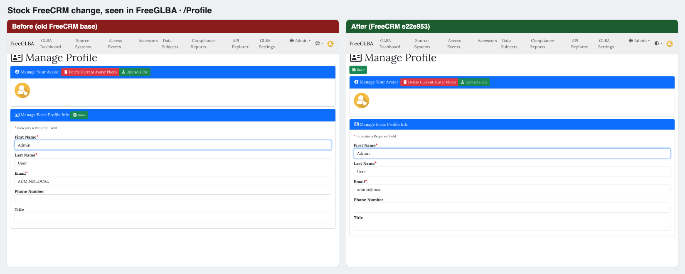 |
| Users table markup (same data) | 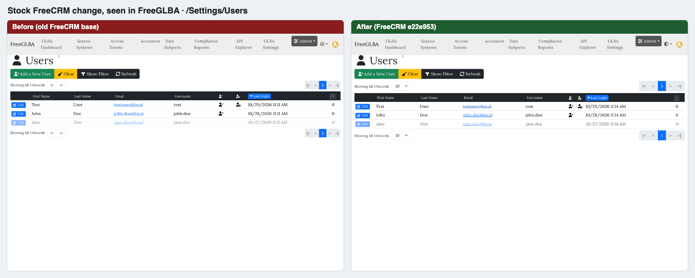 |
| "INVALID USER" heading is now "Invalid User" | 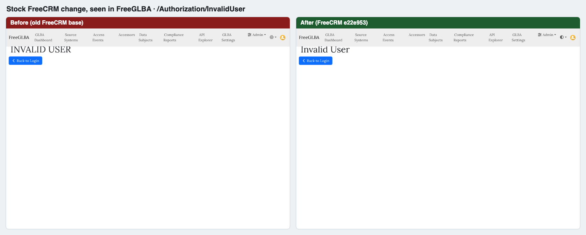 |
| Unknown routes show a "Not Found" page instead of the home page (seen in FreeLLM and ChatWithAI) | 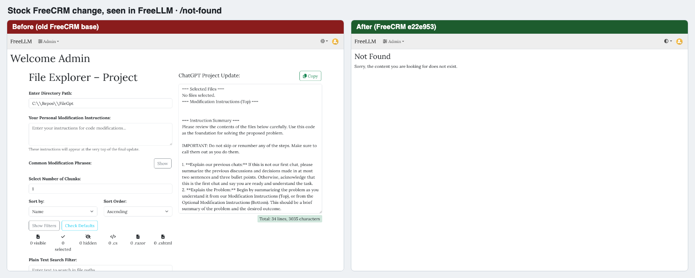 |

Other stock changes:
- **Navbar:** a new theme icon.
- **Test Pages removed:** FreeCRM's sample Test Pages (DoubleClick, Monaco, Sort, Timer, Plugin Testing, DynamicComponent) are gone from every app except FreePlugins, which keeps them on purpose.
- **Modules kept by Util:** About and Logo everywhere, and Tags in the eight apps that had it.

### FreeCRM-file edits that were dropped (to become FreeCRM pull requests)

The rebase keeps FreeCRM's files 100% stock, so fixes the apps had made inside FreeCRM files are gone:

| App(s) | Dropped edit | Verified at HEAD |
|---|---|---|
| FreeGLBA, FreeAccessibilityChecker, FreeBlazorExample | Skip link plus `<main id="main-content">` landmark in `MainLayout.razor` | 0 matches for `Skip to` and `main-content` |
| FreeAccessibilityChecker | `StickyMenuIcon.razor` as a `<button aria-label>`; visually hidden offcanvas dialog titles | `aria-label` 1 → 0, `visually-hidden` 2 → 0 |
| FreeAccessibilityChecker | `Highcharts.razor`: dispose guard and try/catch around chart rendering | `_disposed` 4 → 0 |
| FreeAccessibilityChecker, FreeBlazorExample | `DataAccess.SignalR.cs`: don't fail the request when the SignalR self-post fails | `try` 1 → 0 |
| FreeBlazorExample | InMemory seed-race and thread-safe first-run fixes (`DataAccess.SeedTestData.cs`, `DataAccess.cs`) | stock |
| FreeBlazorExample | bootstrap-icons and thumbmarkjs served locally | now loaded from jsDelivr (`App.razor`) |
| FreeServicesHub, FreeAccessibilityChecker | `EFModelOverrides.cs` namespace | stock |

Some edits were **rebuilt in app code instead of dropped**:
- **FreeServicesHub:** the hub methods moved to `Hubs/FreeServicesHub.App.Hub.cs`.
- **FreeExamples:** the home cards, the dropdown menus (now stock `MenuItem.Children`) and the Monaco language switch.
- **FreePlugins:** the "Plugins" admin menu and the compiled-plugin registration.

**The skip link, evidenced:** the first Tab press after page load reaches "Skip to main content" in the old FreeGLBA, and the brand link in the new one.

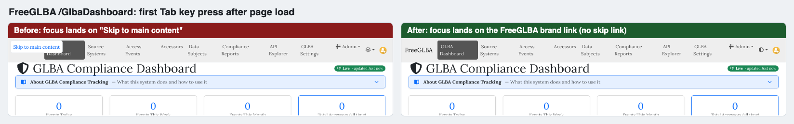

### Build warnings (server project builds)

| App | Before | After |
|---|---|---|
| FreeGLBA | 68 | 17 |
| FreeAccessibilityChecker | 76 | 19 |
| FreeServicesHub | 64 | 7 |
| FreeManager | 54 | 1 |
| FreeExamples | 48 | 4 |
| FreeBlazorExample | 51 | 19 |
| FreePlugins | 66 | 0 |
| FreeLLM | 75 | 16 |
| FreeSmartsheets | 46 | 1 |
| ChatWithAI | 38 | 1 |
| **Total** | **586** | **85** |

All 20 builds: 0 errors.

---

## FreeGLBA

**What it is.** A GLBA (Gramm-Leach-Bliley Act) compliance tracker. Other systems report who accessed which protected financial record, when and why, through an API-key-authenticated API or the bundled NuGet client. The web UI shows:
- a live dashboard;
- access events, accessors and data subjects;
- anomaly flags;
- compliance reports as PDF;
- a SHA-256 hash-chain integrity check.

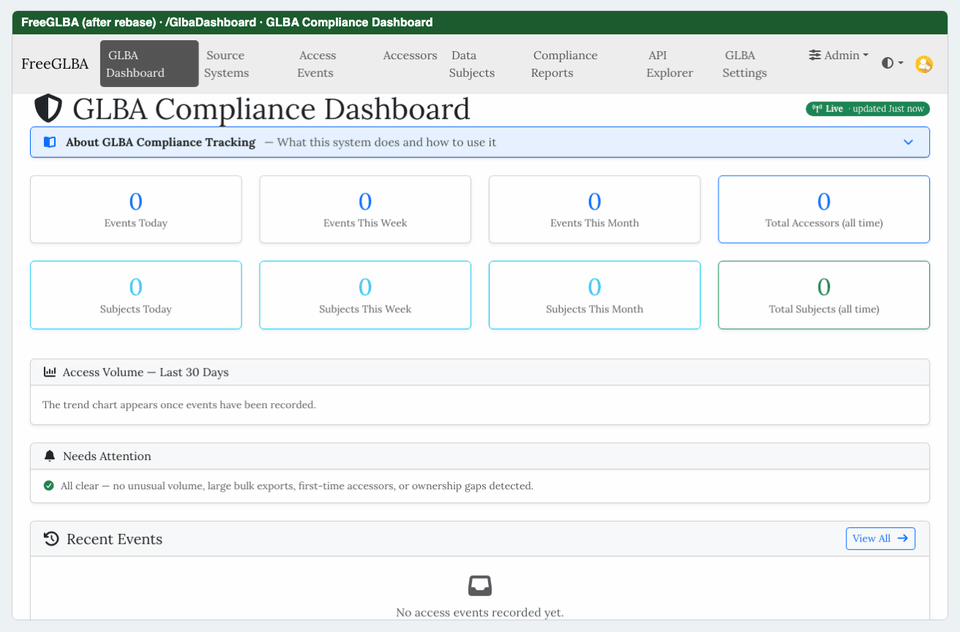

**Major features**

| Feature | Route | Notes |
|---|---|---|
| GLBA Dashboard | `/GlbaDashboard` | Stat tiles, 30-day trend, recent events, "Needs Attention", live SignalR refresh |
| Access Events | `/AccessEvents` | Filter, detail, edit, bulk generate |
| Source Systems (admin menu) | `/SourceSystems` | Registered reporting systems, API keys, chain verification |
| Compliance Reports (admin menu) | `/ComplianceReports` | PDF via QuestPDF |
| API Explorer (admin menu) | `/ApiExplorer` | Try the external API with a source-system key; Scalar/OpenAPI |
| API Logs | `/ApiLogs`, `/ApiLogs/Dashboard`, `/ApiLogs/Settings` | Request log browser and body-logging config |
| GLBA Settings (admin menu) | `/GlbaSettings` | Webhook alerts, timezone |

**How it differs from base FreeCRM** (commit `76127f21`: 96 files added, 7 modified)
- **Hooks (6 lines):**
  - `Helpers.App.cs`: `output.AddRange(Helpers.FreeGLBAMenuItemsApp);` and `if (await FreeGLBAProcessSignalRUpdateApp(update)) { return; }`
  - `Program.App.cs`: `FreeGLBAAppModifyBuilderStart`, `FreeGLBAAppModifyBuilderEnd` and `FreeGLBAAppModifyEnd`
  - `site.App.css`: `@import url("FreeGLBA.App.css");`
- **App code:** 56 `FreeGLBA.App.*` files. The core is `FreeGLBA.App.DataAccess.cs`, `FreeGLBA.App.DataObjects.cs`, `FreeGLBA.App.EFModels.cs`, `FreeGLBA.App.Client.cs` and `Controllers/FreeGLBA.App.API.cs`, plus 42 client UI files.
- **Extra projects:** Docs, NugetClient, NugetClientPublisher, Showcase, TestClient, TestClientWithNugetPackage, and Tests (21 tests).
- **Packages:** `FreeGLBA/FreeGLBA/Directory.Build.props` adds OpenApi and Scalar to the server project only. Settings live in `appsettings.FreeGLBA.App*.json`.

**Deleted or changed in the rebase**
- **Showcase output:** `Docs/showcase/runs/`, 1,341 files, 24.9 MB.
- **FreeCRM samples:** Plugin Testing, the Test Pages and the `Plugins/` sample folder.
- **Unused EF migration:** the stale `InitialMigration` (3 files, 96 KB). It predates the newer tables, and the app creates its schema with `EnsureCreated()`, so nothing used it.
- **Merged files:**
  - 7 DataAccess files → 1, plus the DataObjects, 7 entity files and 5 controller/middleware files merged the same way.
  - 27 UI files renamed to `FreeGLBA.App.UI.*`.
  - Old app code was 67 files / 760 KB and is now 76 files / 786 KB. Nothing material was lost.

**Fixes forced by e22e953:** QuestPDF no longer bundles system fonts, so `Fonts.Arial` is now `Fonts.Lato` in `FreeGLBA.App.DataAccess.cs:1426` and `:1608`. PDF reports use a different font.

**Before and after**

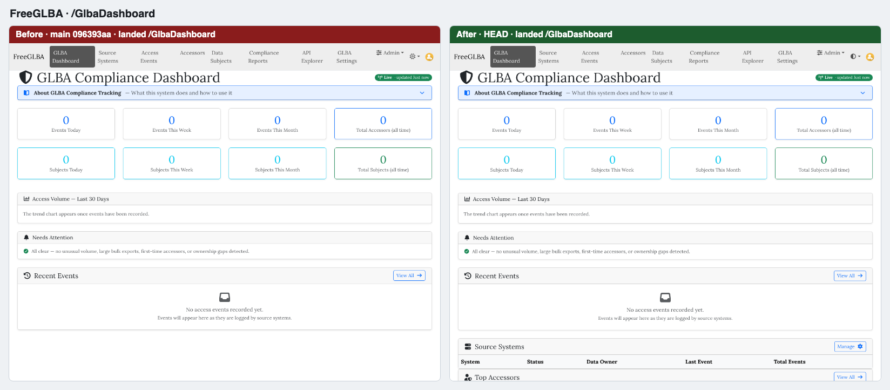
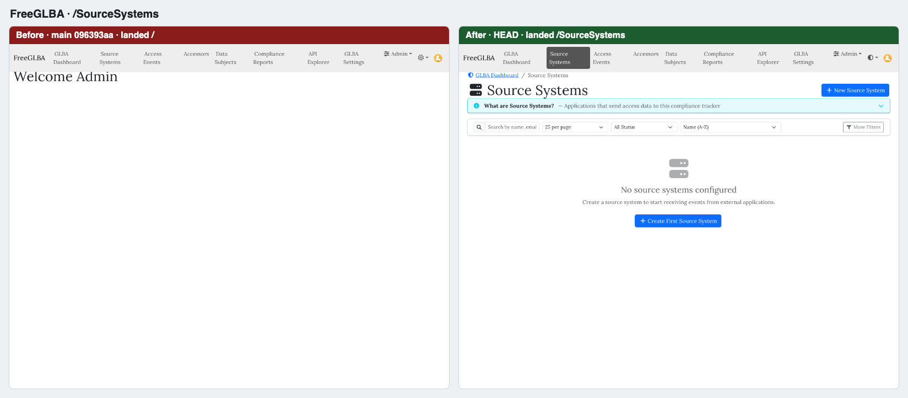

**Route-by-route evidence**

**Crawl:** 47 routes; logged in on both sides: yes.

| Verdict | Routes | Meaning |
|---|---|---|
| same | 0 | Same landing page, heading and text; pixels within 1.5% |
| same content | 37 | Same landing page, heading and text; pixels differ (page chrome moved) |
| changed | 10 | Listed below with the reason |

On every page: removed "Skip to main content". This is ignored in the per-route verdicts.

| Route | Before → after landing | Reason |
|---|---|---|
| `/Authorization/InvalidUser` | `/Authorization/InvalidUser` → `/Authorization/InvalidUser` | Stock e22e953: heading is now "Invalid User" (was "INVALID USER"). |
| `/DoubleClick` | `/DoubleClick` → `/` | FreeCRM sample test page: removed by Util (SamplePages not kept), so it now falls back to home. |
| `/Error` | `/` → `/Error` | Stock e22e953: /Error handling. |
| `/Monaco` | `/Monaco` → `/` | FreeCRM sample test page: removed by Util (SamplePages not kept), so it now falls back to home. |
| `/Plugins` | `/Plugins` → `/` | FreeCRM sample test page: removed by Util (SamplePages not kept), so it now falls back to home. |
| `/Profile` | `/Profile` → `/Profile` | Stock e22e953: Profile page layout. |
| `/Settings/Users` | `/Settings/Users` → `/Settings/Users` | Stock e22e953: Users table markup (same data, cells render separately). |
| `/SortTest` | `/` → `/` | Both versions send this FreeCRM test page to home in this configuration; only the page chrome differs. |
| `/SourceSystems` | `/` → `/SourceSystems` | Before: redirected to home during the crawl; after: the page loads. |
| `/TimerTest` | `/TimerTest` → `/` | FreeCRM sample test page: removed by Util (SamplePages not kept), so it now falls back to home. |

<details><summary>37 routes with the same content</summary>

`/` · `/About` · `/AccessEvents` · `/Accessors` · `/ApiExplorer` · `/ApiLogs` · `/ApiLogs/Dashboard` · `/ApiLogs/Settings` · `/Authorization/AccessDenied` · `/Authorization/NoLocalAccount` · `/ChangePassword` · `/ComplianceReports` · `/DataSubjects` · `/GlbaDashboard` · `/GlbaSettings` · `/InvalidTenantCode` · `/MissingTenantCode` · `/PasswordChanged` · `/Settings` · `/Settings/AddDepartment` · `/Settings/AddDepartmentGroup` · `/Settings/AddTag` · `/Settings/AddTenant` · `/Settings/AddUser` · `/Settings/AddUserGroup` · `/Settings/AppSettings` · `/Settings/DeletedRecords` · `/Settings/DepartmentGroups` · `/Settings/Departments` · `/Settings/Files` · `/Settings/Language` · `/Settings/Tags` · `/Settings/Tenants` · `/Settings/UDF` · `/Settings/UserGroups` · `/Setup` · `/not-found`

</details>

Raw results: [`RebaseReport/FreeGLBA/evidence-compare.json`](RebaseReport/FreeGLBA/evidence-compare.json)

<details><summary>All FreeGLBA feature screenshots</summary>

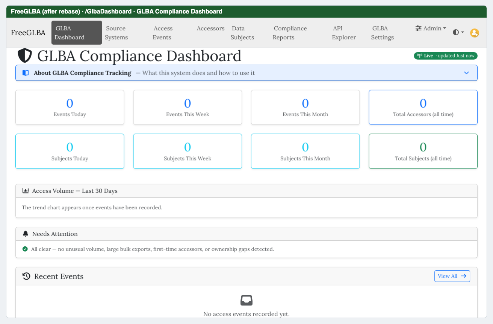
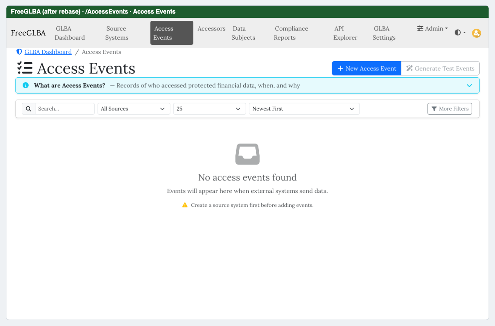
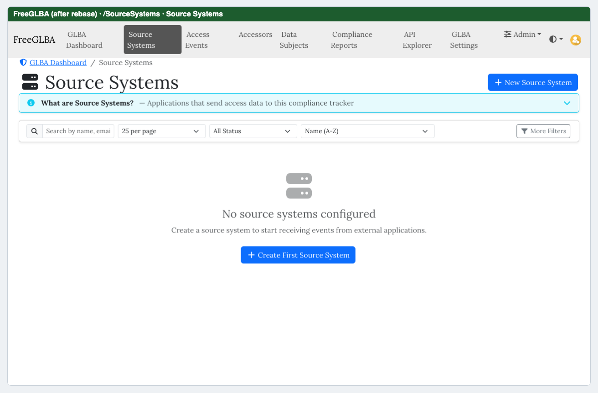
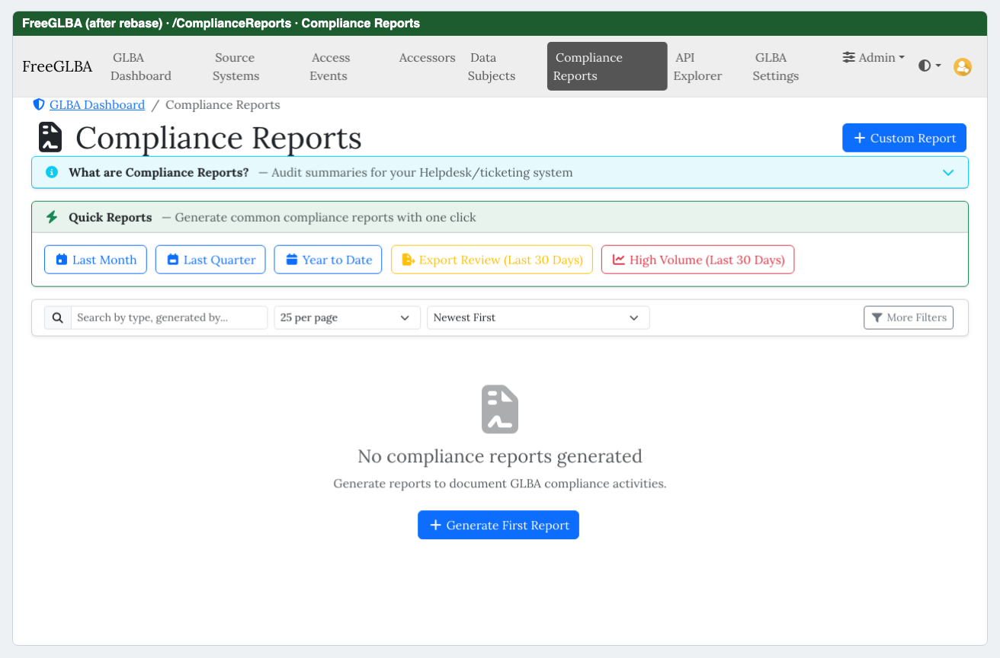
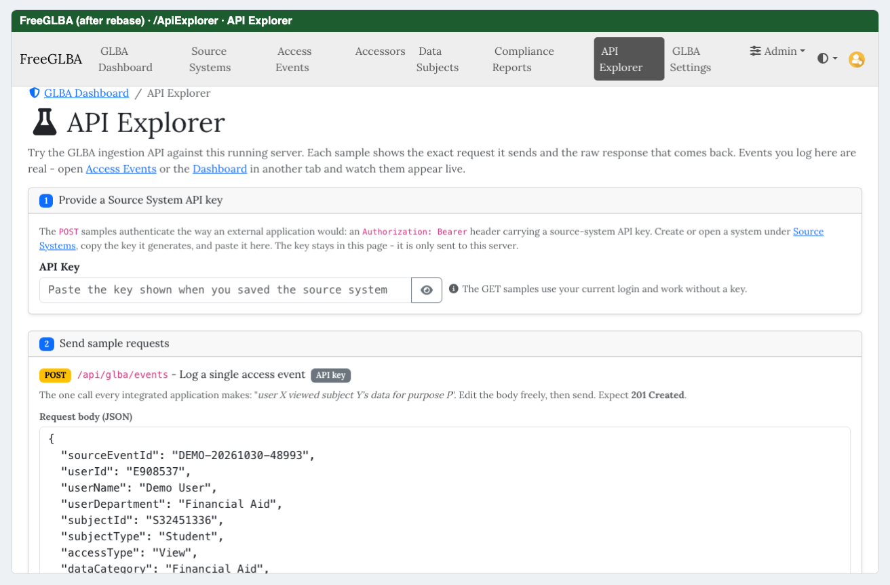
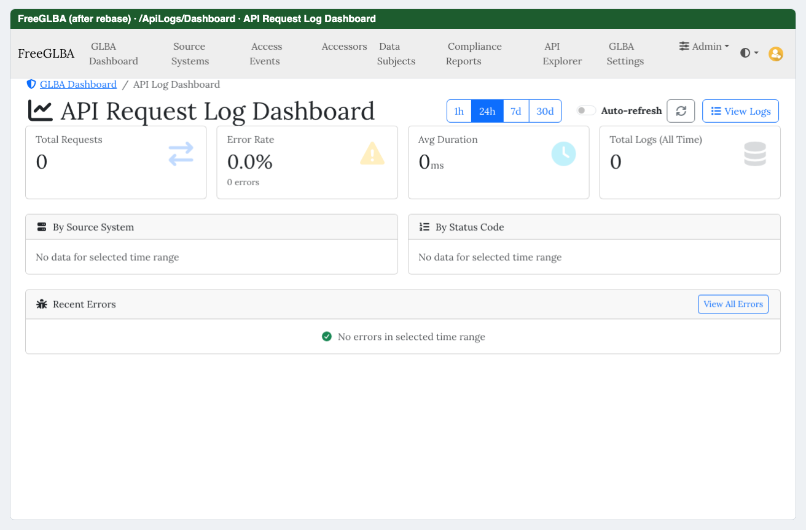
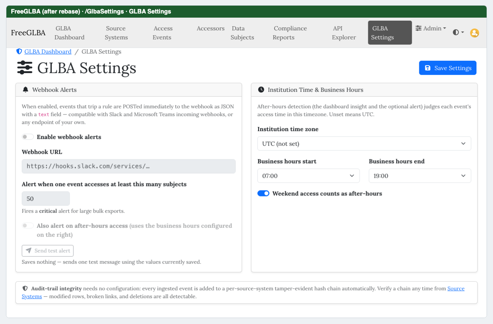

</details>

**Open items:**
- **Skip link:** gone; see above.
- **Docs:** they still link to `showcase/runs/…`.
- **Admin pages:** Source Systems, Compliance Reports, API Explorer and GLBA Settings are hidden in the menu for non-admins, but the pages themselves have no admin check. The server API checks `CurrentUser.Admin` for the destructive calls.

---

## FreeAccessibilityChecker

**What it is.** A WCAG 2.1/2.2 AA auditing platform. A Playwright scanner runs four engines (axe-core, IBM Equal Access, HTML CodeSniffer, and a custom HtmlChecker) and stores results per site and page. The UI shows compliance status, rule triage, trends and audit reports. It also ships a console scanner and the A11yAudit batch tool.

**Renamed from FreeA11yChecker** because FreeCRM's Util only accepts letters in project names. The SignalR hub is now `freeaccessibilitycheckerHub`.

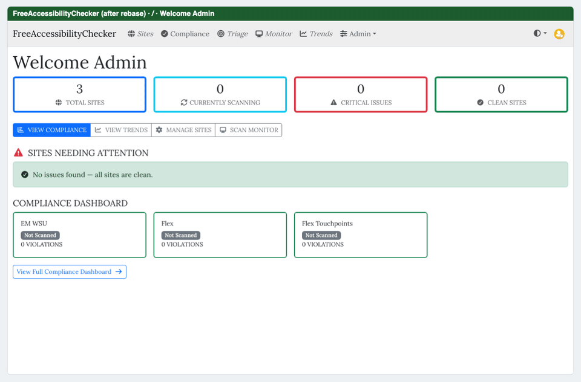

**Major features**

| Feature | Route | Notes |
|---|---|---|
| Home | `/` | `FreeAccessibilityChecker_App_UI_Home` through the Index hook |
| Compliance dashboard | `/Compliance` | Per-site status cards and table |
| Sites (admin) | `/Settings/Sites` | Add sites, schedules, credentials |
| Triage (admin) | `/Compliance/Scorecard`, `/Compliance/Rules` | Cross-site violation ranking |
| Scan Monitor (admin) | `/Settings/ScanMonitor` | Live scan log |
| Trends (admin) | `/Reports/Trends`, `/Reports/Audit/{SiteId}` | Highcharts trends, audit report |
| Scan and page detail | `/Scans/{id}`, `/Pages/{id}` | Violations, screenshots, overlays (needs scan data) |

**How it differs from base FreeCRM** (commit `b3f09d4c`: 246 added, 11 modified)
- **Hooks (14 lines):**
  - `Helpers.App.cs` has 4: icons, menu, SignalR, model reload.
  - `DataAccess.App.cs` has 3: delete records, data model, background tasks.
  - `Program.App.cs` has 4.
  - `About.App.razor`, `Index.App.razor` and `site.App.css` have 1 each.
- **App code:** 53 `FreeAccessibilityChecker.App.*` files.
- **Extra projects:** Console, Scanner, A11yAudit (14 source and config files) and Docs, plus the **BlazorApp1** test site (124 files) and `ACCESSIBILITY_GUIDELINES.md`. BlazorApp1 is the stock .NET 10 Blazor template with an InMemory database and a seeded `admin@example.com`, used as a scan target.
- **Packages:** `Directory.Build.props` (server only) adds the Scanner reference, Playwright 1.56.0 and NCrontab.

**Deleted or changed in the rebase**
- **A11yAudit results:** 2,203 files, 1.19 GB, all regenerable. This is the largest single removal in the repo.
- **Showcase output:** `Docs/showcase/runs/`, 2,017 files, 23.5 MB.
- **Renamed files:** 557, mostly the rename itself.
- **Merged files:** the DataAccess, EF entity and API files.
- **Dropped edits:** all the FreeCRM-file edits listed in [Changes common to every app](#changes-common-to-every-app) for this app. They are gone, and so is the app's `EFDataModelDesignTimeFactory.cs`.

**Fixes forced by e22e953:** removed the QuestPDF 2026.2.4 pin, which stock's 2026.9.1 would otherwise downgrade (NU1605).

**Before and after**

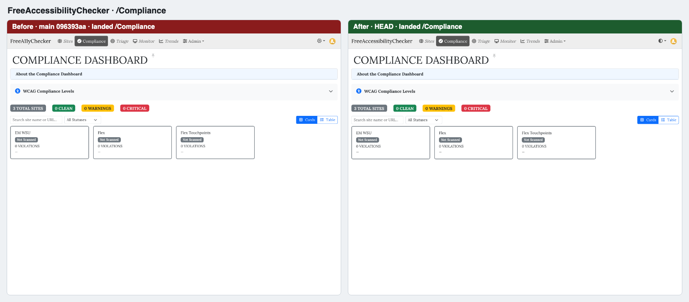
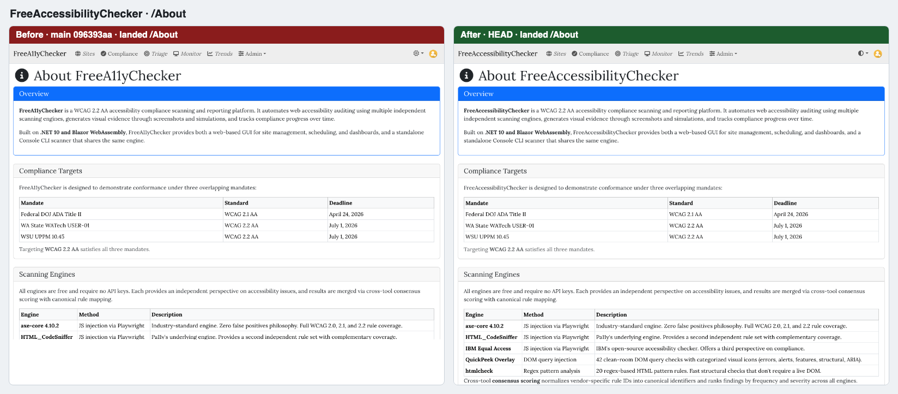

**Route-by-route evidence**

**Crawl:** 75 routes (33 belong to the bundled BlazorApp1 test site); logged in on both sides: yes.

| Verdict | Routes | Meaning |
|---|---|---|
| same | 0 | Same landing page, heading and text; pixels within 1.5% |
| same content | 39 | Same landing page, heading and text; pixels differ (page chrome moved) |
| changed | 3 | Listed below with the reason |

On every page: removed "Skip to main content". This is ignored in the per-route verdicts.

| Route | Before → after landing | Reason |
|---|---|---|
| `/Authorization/InvalidUser` | `/Authorization/InvalidUser` → `/Authorization/InvalidUser` | Stock e22e953: heading is now "Invalid User" (was "INVALID USER"). |
| `/Profile` | `/Profile` → `/Profile` | Stock e22e953: Profile page layout. |
| `/Settings/Users` | `/Settings/Users` → `/Settings/Users` | Stock e22e953: Users table markup (same data, cells render separately). |

33 BlazorApp1 test-site routes (`/Account/*`, `/counter`, `/weather`, `/auth`) were crawled too; they are not part of the app and are left out of the counts above.

<details><summary>39 routes with the same content</summary>

`/` · `/About` · `/Authorization/AccessDenied` · `/Authorization/NoLocalAccount` · `/ChangePassword` · `/Compliance` · `/Compliance/Rules` · `/Compliance/Scorecard` · `/Compliance/Search` · `/Compliance/Tree` · `/Error` · `/InvalidTenantCode` · `/MissingTenantCode` · `/PasswordChanged` · `/Reports/Trends` · `/Scans` · `/Settings` · `/Settings/AddDepartment` · `/Settings/AddDepartmentGroup` · `/Settings/AddTag` · `/Settings/AddTenant` · `/Settings/AddUser` · `/Settings/AddUserGroup` · `/Settings/AppSettings` · `/Settings/DeletedRecords` · `/Settings/DepartmentGroups` · `/Settings/Departments` · `/Settings/Files` · `/Settings/Language` · `/Settings/ScanMonitor` · `/Settings/Sites` · `/Settings/Suppressions` · `/Settings/Tags` · `/Settings/Tenants` · `/Settings/UDF` · `/Settings/UserGroups` · `/Setup` · `/not-found` · `/tenant1/Authorization/NoLocalAccout`

</details>

Raw results: [`RebaseReport/FreeAccessibilityChecker/evidence-compare.json`](RebaseReport/FreeAccessibilityChecker/evidence-compare.json)

<details><summary>All FreeAccessibilityChecker feature screenshots</summary>

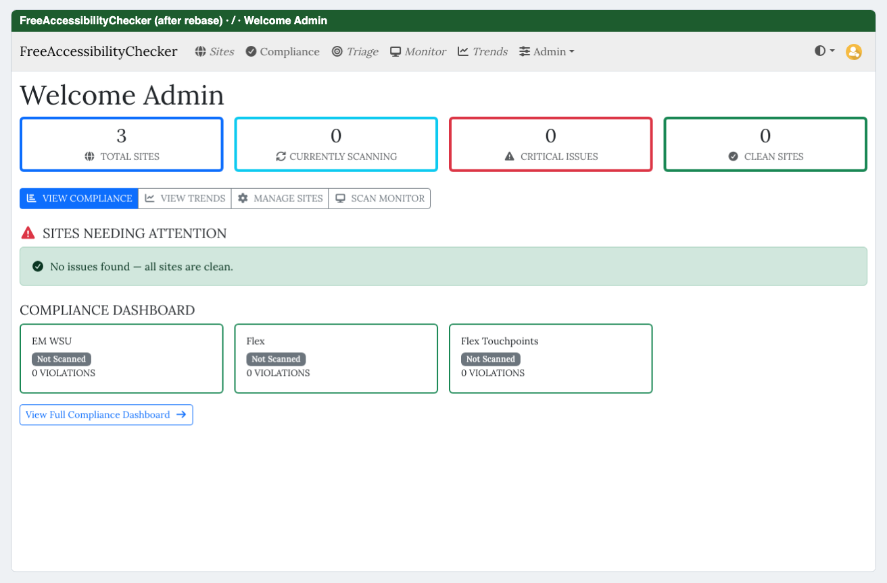
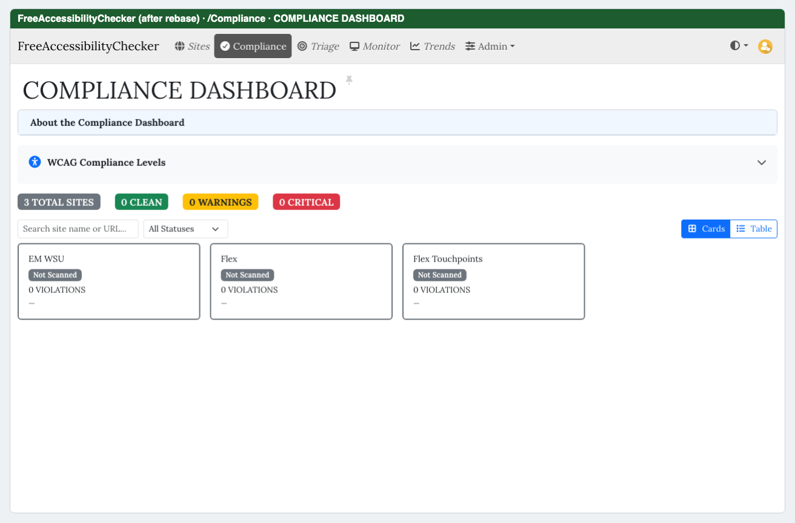
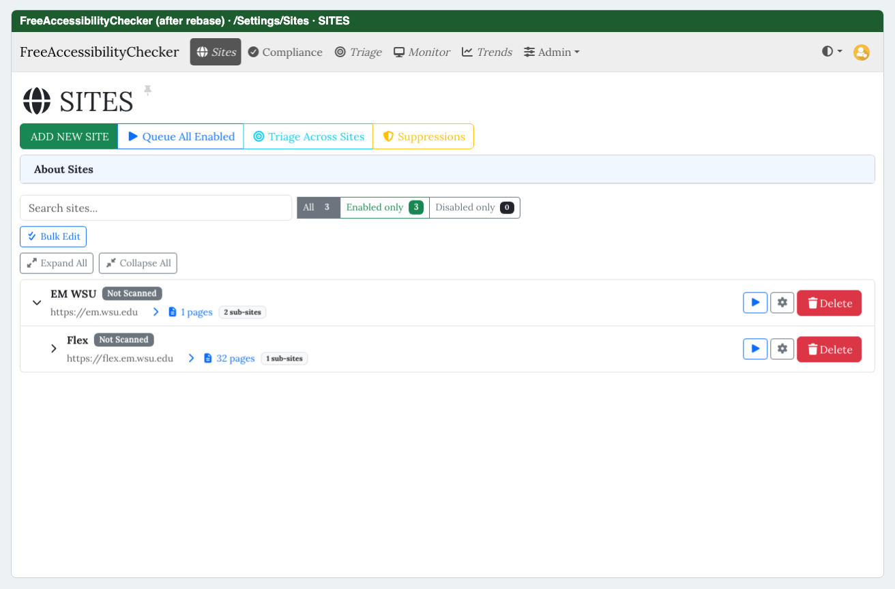
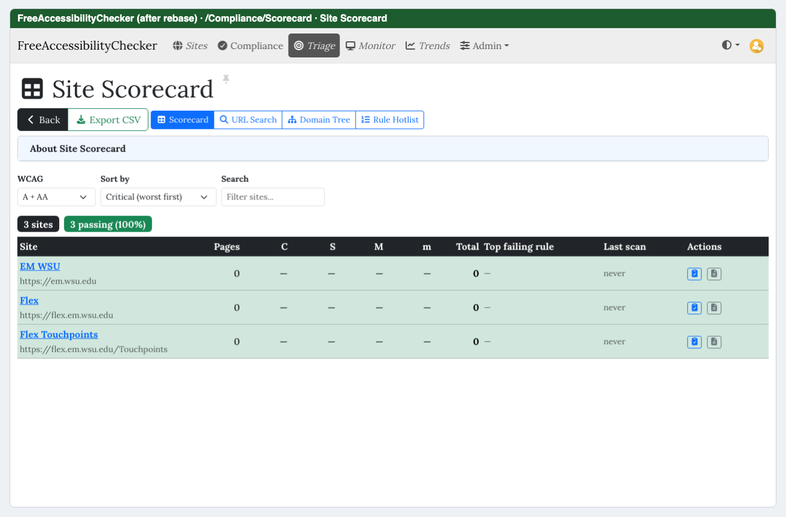
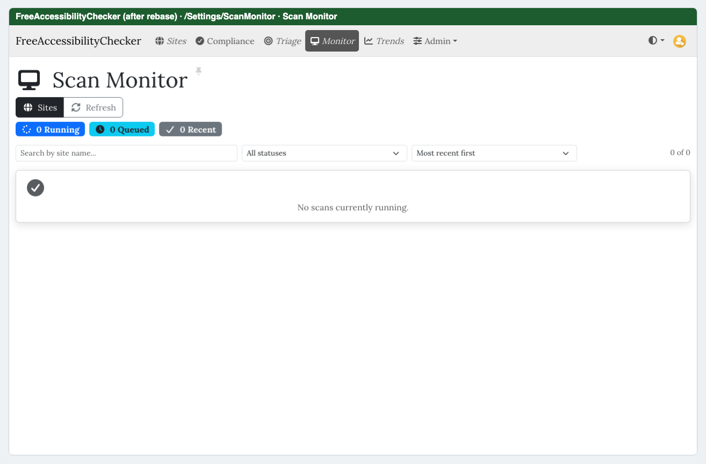
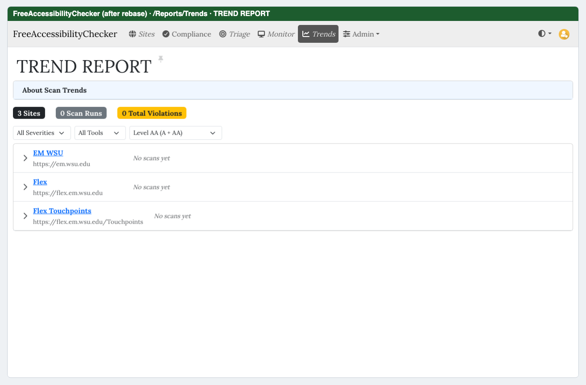

</details>

**Open items:**
- **Accessibility regressions in an accessibility tool:** its own pages now lack the skip link, `<main>` landmark, sticky-menu button label and offcanvas dialog titles.
- **Stale README:** `FreeAccessibilityChecker.EFModels/FreeAccessibilityChecker.App.README.md` still documents the removed design-time factory.
- **Old repo name:** `README.md` and `Docs/005_plugins.md` still link to `WSU-EIT/FreeA11yChecker`.

---

## FreeServicesHub

**What it is.** A hub-and-agent fleet monitor. A Windows-service agent on each machine registers with the Blazor hub, sends a CPU, memory and disk heartbeat about every 30 seconds over SignalR, and receives settings and jobs back. It ships with an installer, an Aspire AppHost and integration tests.

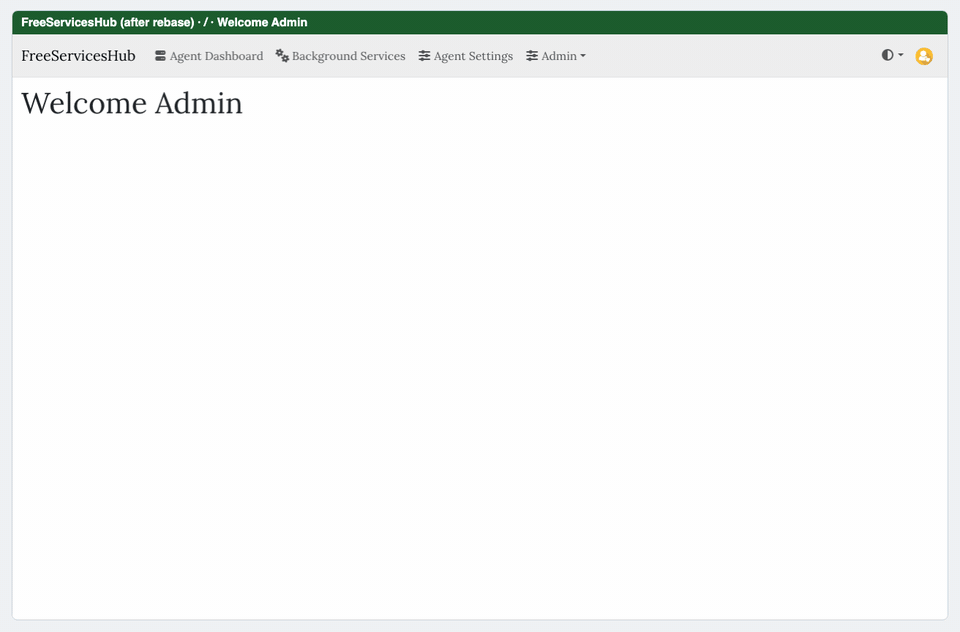

**Major features**

| Feature | Route | Notes |
|---|---|---|
| Agent Dashboard | `/AgentDashboard` | Live agent cards (empty without a running agent) |
| Agent Management (admin) | `/AgentManagement` | Register agents, registration keys |
| Background Services | `/BackgroundServices` | Hub services and their live log |
| Agent Settings | `/AgentSettings` | Push per-agent settings over SignalR |
| API Keys (admin) | `/Settings/ApiKeys` | |
| About | `/About` | App description and API table |

**How it differs from base FreeCRM** (commit `6eef9375`: 78 added, 11 modified)
- **Hooks (16 lines):**
  - `Helpers.App.cs` has 5.
  - `DataAccess.App.cs` has 3.
  - `Program.App.cs` has 5.
  - `About.App.razor`, `Index.App.razor` and `site.App.css` have 1 each.
- **App code:** 33 `FreeServicesHub.App.*` files.
- **Hub methods:** the methods that used to be edited into stock `signalrHub.cs` now live in `Hubs/FreeServicesHub.App.Hub.cs`.
- **Extra projects:** Agent, Agent.Installer, AppHost (Aspire), TestMe, Tests.Integration and Docs, plus `Pipelines/` and `.azure-pipelines/` with paths updated for the flat layout.
- **Packages:** `Directory.Build.props` adds the EF Sqlite package that stock FreeCRM dropped.

**Deleted or changed in the rebase**
- **Flattened:** the three-level layout became one level, and three sets of README/LICENSE/slnx became one.
- **Showcase output:** 116 files, 2 MB.
- **Merged files:** 6 DataAccess files → 1, plus the DataObjects, EF entities and 4 server files.

**Fixes forced by e22e953:**
- The EF Sqlite package, via `Directory.Build.props`.
- The integration tests' `SignalR.Client` went from 10.0.5 to 10.0.13.

**Before and after**

The home page is empty in both versions. `Index.App.razor` calls `<FreeServicesHub_App_AgentDashboard />`, but the component is named `FreeServicesHub_App_UI_AgentDashboard`, so Razor renders an unknown tag and nothing shows. This bug already existed before the rebase.

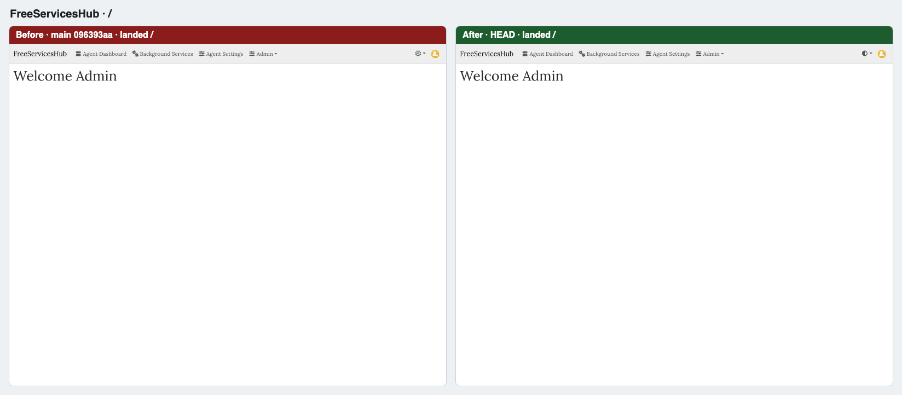
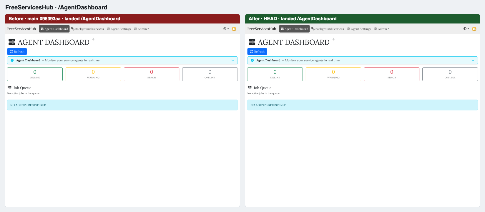

**Route-by-route evidence**

**Crawl:** 37 routes; logged in on both sides: yes.

| Verdict | Routes | Meaning |
|---|---|---|
| same | 29 | Same landing page, heading and text; pixels within 1.5% |
| same content | 3 | Same landing page, heading and text; pixels differ (page chrome moved) |
| changed | 5 | Listed below with the reason |

| Route | Before → after landing | Reason |
|---|---|---|
| `/About` | `/About` → `/About` | The About page's project-structure text now describes the flat layout and the new App file names. |
| `/Authorization/InvalidUser` | `/Authorization/InvalidUser` → `/Authorization/InvalidUser` | Stock e22e953: heading is now "Invalid User" (was "INVALID USER"). |
| `/BackgroundServices` | `/BackgroundServices` → `/BackgroundServices` | Live service log timestamps (clock noise). |
| `/Profile` | `/Profile` → `/Profile` | Stock e22e953: Profile page layout. |
| `/Settings/Users` | `/Settings/Users` → `/Settings/Users` | Stock e22e953: Users table markup (same data, cells render separately). |

<details><summary>32 routes with the same content</summary>

`/` · `/AgentDashboard` · `/AgentManagement` · `/AgentSettings` · `/Authorization/AccessDenied` · `/Authorization/NoLocalAccount` · `/ChangePassword` · `/Error` · `/InvalidTenantCode` · `/MissingTenantCode` · `/PasswordChanged` · `/Settings` · `/Settings/AddDepartment` · `/Settings/AddDepartmentGroup` · `/Settings/AddTag` · `/Settings/AddTenant` · `/Settings/AddUser` · `/Settings/AddUserGroup` · `/Settings/ApiKeys` · `/Settings/AppSettings` · `/Settings/DeletedRecords` · `/Settings/DepartmentGroups` · `/Settings/Departments` · `/Settings/Files` · `/Settings/Language` · `/Settings/Tags` · `/Settings/Tenants` · `/Settings/UDF` · `/Settings/UserGroups` · `/Setup` · `/not-found` · `/tenant1/Authorization/NoLocalAccout`

</details>

Raw results: [`RebaseReport/FreeServicesHub/evidence-compare.json`](RebaseReport/FreeServicesHub/evidence-compare.json)

<details><summary>All FreeServicesHub feature screenshots</summary>

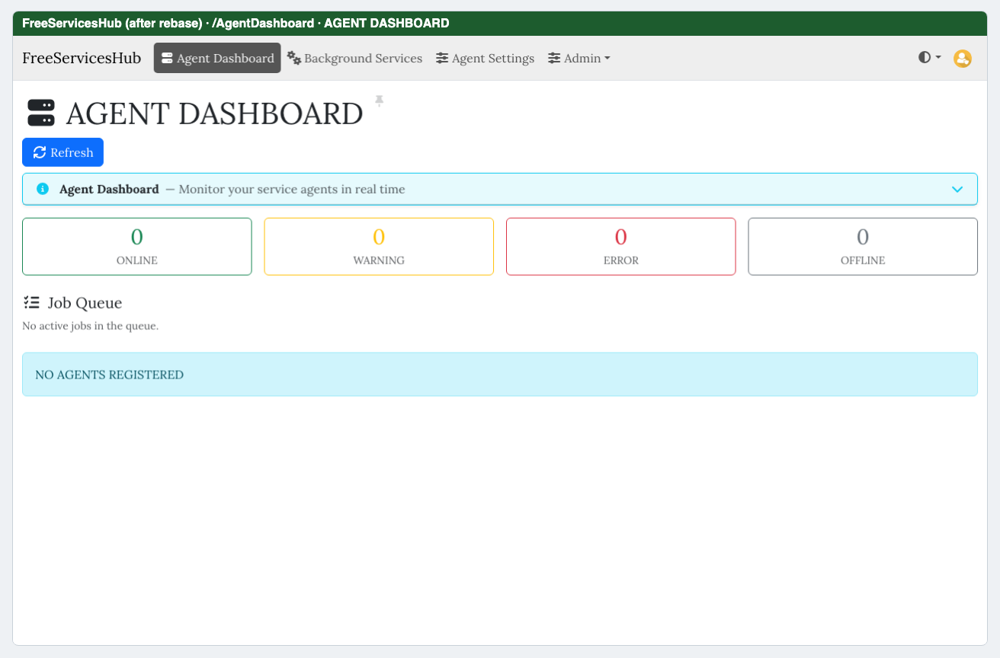
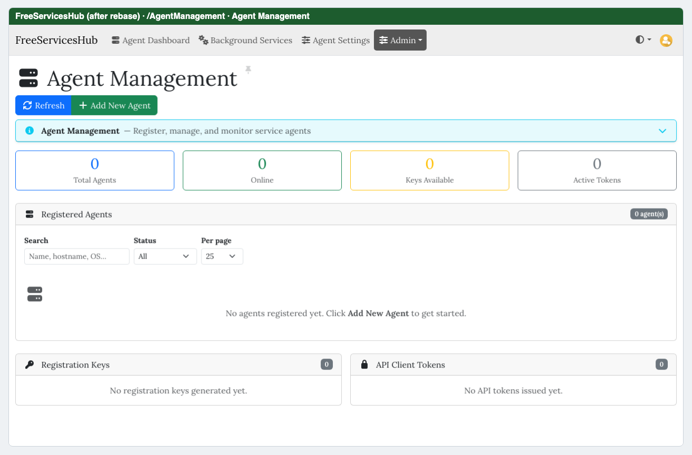
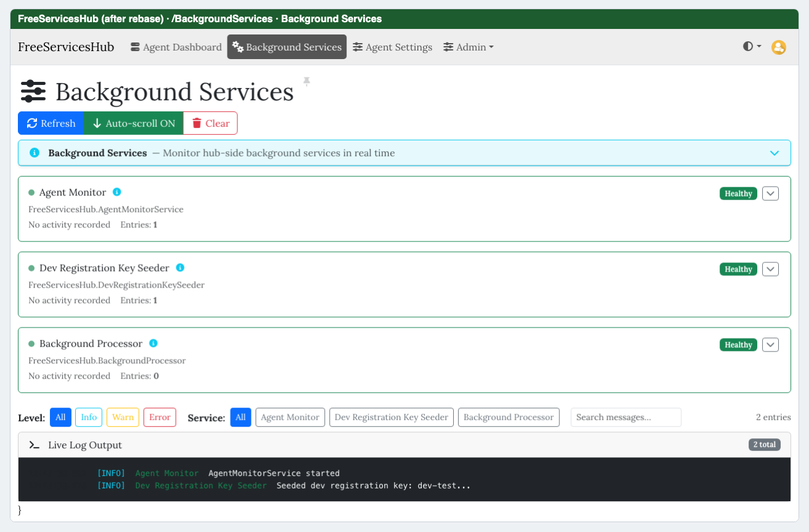
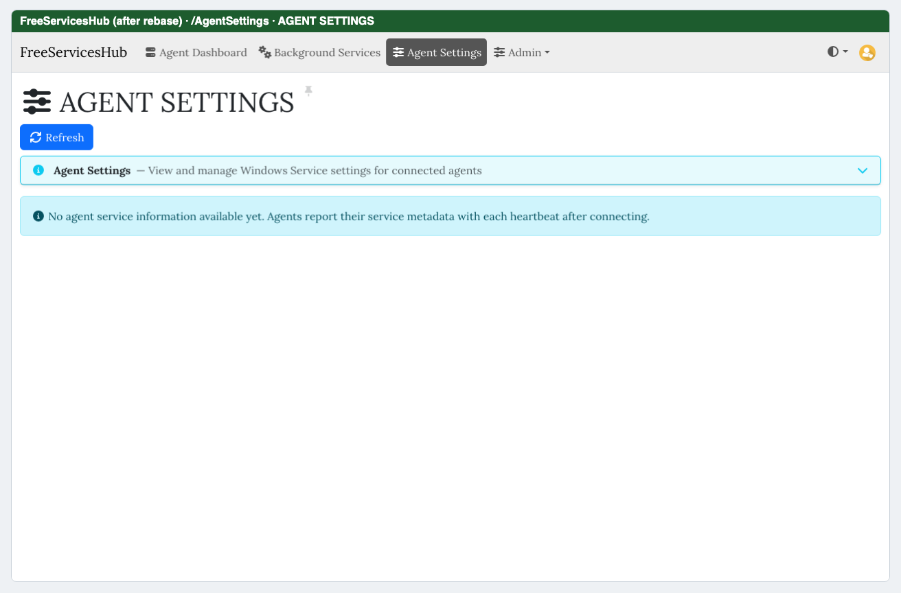
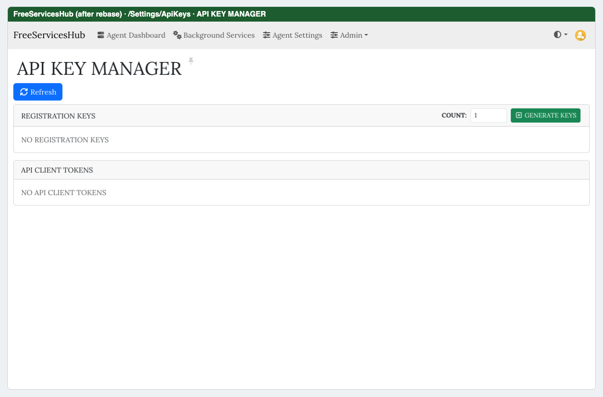
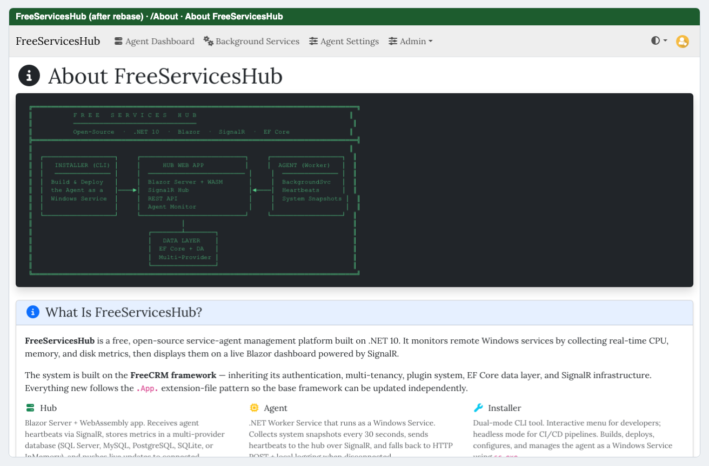

</details>

**Open items:**
- **Home hook name:** fix the component name in `Index.App.razor` (one line).
- **Stale README:** `README.md` still lists `CRM.*` projects.
- **Agent package:** the Agent pins `SignalR.Client` 10.0.0-preview.
- **Not run against real services:** the integration tests and the EF migrations path.

---

## FreeManager

**What it is.** An application builder and code generator for FreeCRM apps. In the browser, a developer defines entities, properties, relationships and enums, previews the generated C# and Razor, and exports it. `FreeManager.Cli` does the same from the command line.


**Major features**

| Feature | Route | Notes |
|---|---|---|
| My Projects | `/AppBuilder` | Project list |
| New Project / templates | `/Templates`, `/AppBuilder/New` | Skeleton, Starter, FullCrud |
| Project Editor | `/AppBuilder/Edit/{id}` | Files, versions, builds, export |
| Entity Wizard (admin "Archive" menu) | `/AppBuilder/EntityWizard` | 7-step wizard, 20+ sub-components |
| Template Gallery, Setup Wizard Builder | `/fm/templates`, `/AppBuilder/SetupWizardBuilder` | |

**How it differs from base FreeCRM** (commit `69fce16f`: 65 added, 9 modified)
- **Hooks (6 lines):**
  - `Helpers.App.cs` has 3: icons, menu, admin menu.
  - `DataAccess.App.cs` has 1: language.
  - `Program.App.cs` has 1.
  - `Modules.App.razor` (`head`) has 1. It loads `FreeManager.App.css`, which holds the styles that used to be inline.
- **App code:** 47 `FreeManager.App.*` files. The code generator's template strings are in `FreeManager.App.PagePatterns.cs` (8,255 lines), `ProjectTemplates`, `WizardTemplates` and `EntityTemplates`.
- **Extra projects:** Cli and Docs.

**Deleted or changed in the rebase**
- **Showcase output:** 1,445 files, 26.8 MB.
- **Old tools:** `Rename FreeCRM.exe` and `Remove Modules from FreeCRM.exe`, 1 MB.
- **Stray generated output:** `FreeManager.Cli/FreeGLBA/`, 27 files, 123 KB of generated GLBA output that nothing referenced.
- **FreeCRM samples:** removed.
- **Merged files:** 17 template files → 4, plus the DataAccess, DataObjects and entities.

**Dropped FreeCRM-file edits:** none found.

**Before and after**

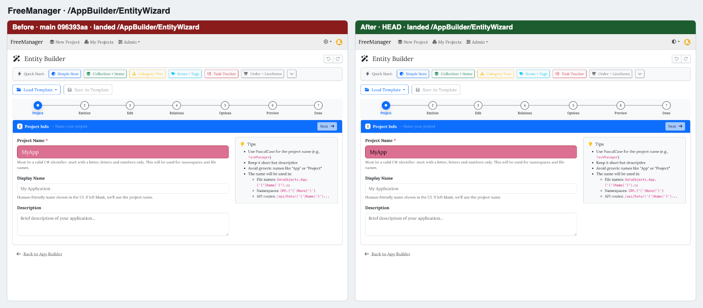
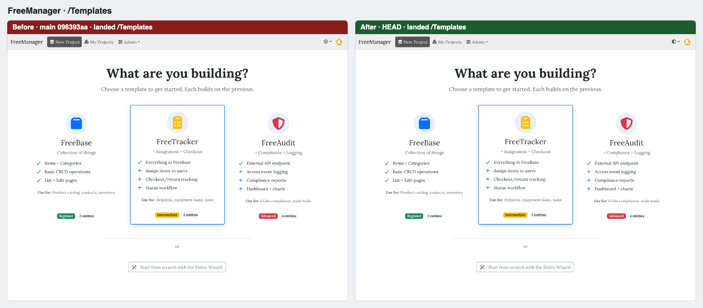

**Route-by-route evidence**

**Crawl:** 50 routes; logged in on both sides: yes.

| Verdict | Routes | Meaning |
|---|---|---|
| same | 38 | Same landing page, heading and text; pixels within 1.5% |
| same content | 3 | Same landing page, heading and text; pixels differ (page chrome moved) |
| changed | 9 | Listed below with the reason |

| Route | Before → after landing | Reason |
|---|---|---|
| `/Authorization/InvalidUser` | `/Authorization/InvalidUser` → `/Authorization/InvalidUser` | Stock e22e953: heading is now "Invalid User" (was "INVALID USER"). |
| `/DoubleClick` | `/DoubleClick` → `/DoubleClick` | FreeCRM sample test page: removed by Util (SamplePages not kept), so it now falls back to home. |
| `/Error` | `/` → `/Error` | Stock e22e953: /Error handling. |
| `/Monaco` | `/Monaco` → `/` | FreeCRM sample test page: removed by Util (SamplePages not kept), so it now falls back to home. |
| `/Plugins` | `/Plugins` → `/` | FreeCRM sample test page: removed by Util (SamplePages not kept), so it now falls back to home. |
| `/Profile` | `/Profile` → `/Profile` | Stock e22e953: Profile page layout. |
| `/Settings/Users` | `/Settings/Users` → `/Settings/Users` | Stock e22e953: Users table markup (same data, cells render separately). |
| `/SourceSystems` | `/` → `/SourceSystems` | Route came from stray generated GLBA pages under the old FreeManager.Cli/FreeGLBA/ (deleted); not a FreeManager page. |
| `/TimerTest` | `/TimerTest` → `/` | FreeCRM sample test page: removed by Util (SamplePages not kept), so it now falls back to home. |

<details><summary>41 routes with the same content</summary>

`/` · `/About` · `/AccessEvents` · `/AppBuilder` · `/AppBuilder/Dashboard` · `/AppBuilder/EntityWizard` · `/AppBuilder/New` · `/AppBuilder/SetupWizardBuilder` · `/Authorization/AccessDenied` · `/Authorization/NoLocalAccount` · `/ChangePassword` · `/ComplianceReports` · `/DataSubjects` · `/GlbaDashboard` · `/InvalidTenantCode` · `/MissingTenantCode` · `/PasswordChanged` · `/Settings` · `/Settings/AddDepartment` · `/Settings/AddDepartmentGroup` · `/Settings/AddTag` · `/Settings/AddTenant` · `/Settings/AddUser` · `/Settings/AddUserGroup` · `/Settings/AppSettings` · `/Settings/DeletedRecords` · `/Settings/DepartmentGroups` · `/Settings/Departments` · `/Settings/Files` · `/Settings/Language` · `/Settings/Tags` · `/Settings/Tenants` · `/Settings/UDF` · `/Settings/UserGroups` · `/Setup` · `/SortTest` · `/Templates` · `/Templates/Setup` · `/fm/templates` · `/not-found` · `/tenant1/Authorization/NoLocalAccout`

</details>

Raw results: [`RebaseReport/FreeManager/evidence-compare.json`](RebaseReport/FreeManager/evidence-compare.json)

<details><summary>All FreeManager feature screenshots</summary>

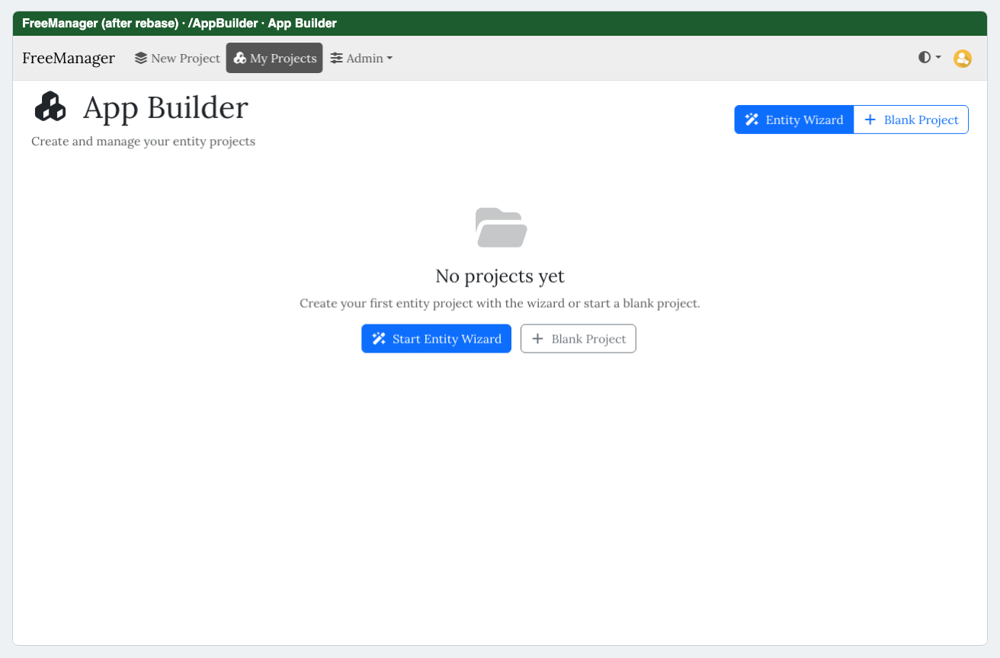
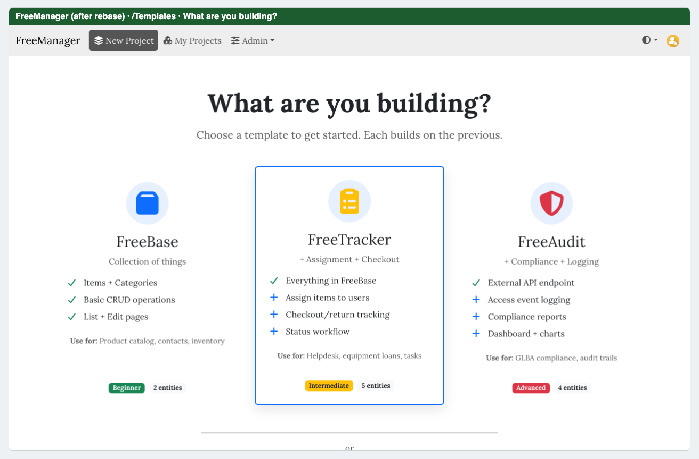
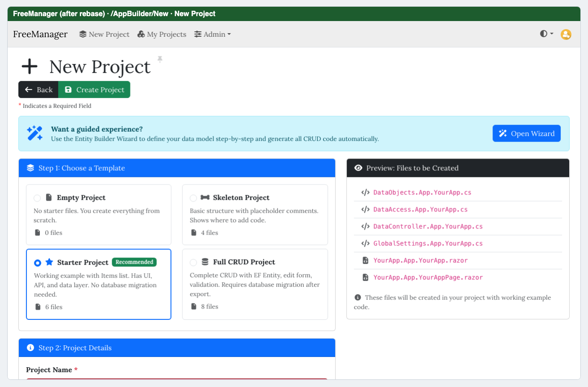
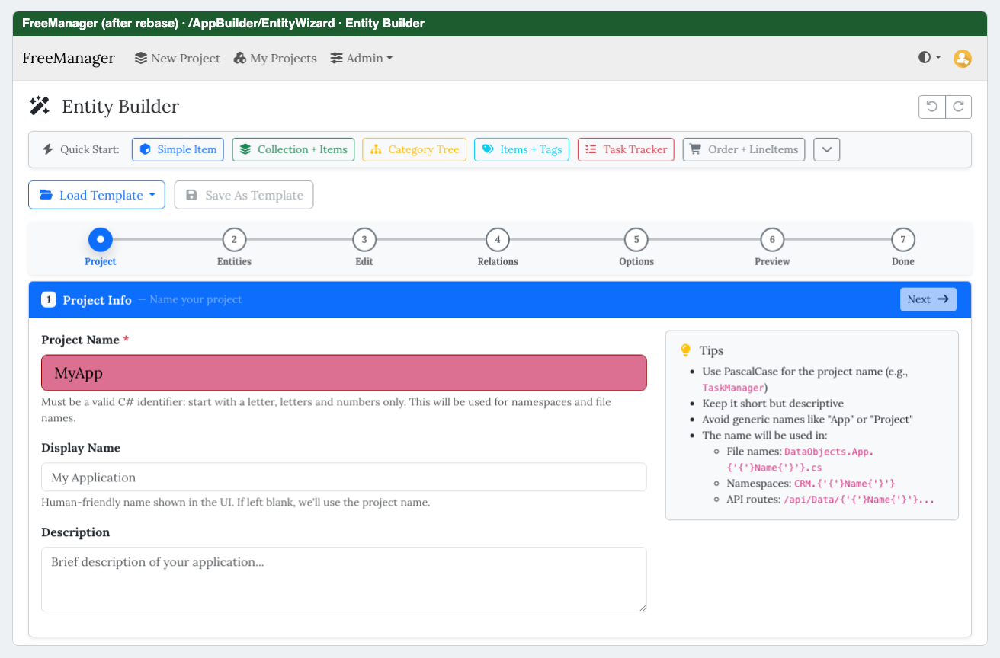
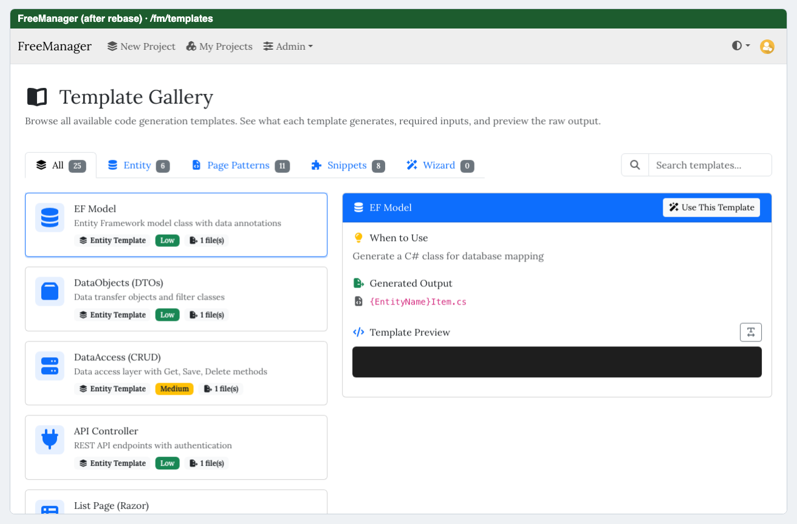
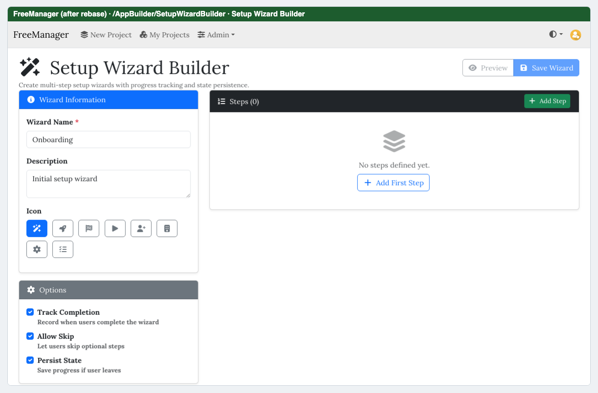

</details>

**Open items:**
- **Database:** `appsettings.FreeManager.App.json` sets the InMemory database for every environment. This is an older open decision.
- **Stale comment:** the header comment in `FreeManager.App.css` names the wrong loader file.

---

## FreeExamples

**What it is.** A learning playground of 105 interactive example pages in 7 categories:
- Dashboard & Data
- Files & Media
- UI Components
- Charts & Viz
- Code & Real-Time
- Project Management
- Domain Workflows

It also has a demo API with a NuGet client. It moved out of `FreeTools/` to the root.

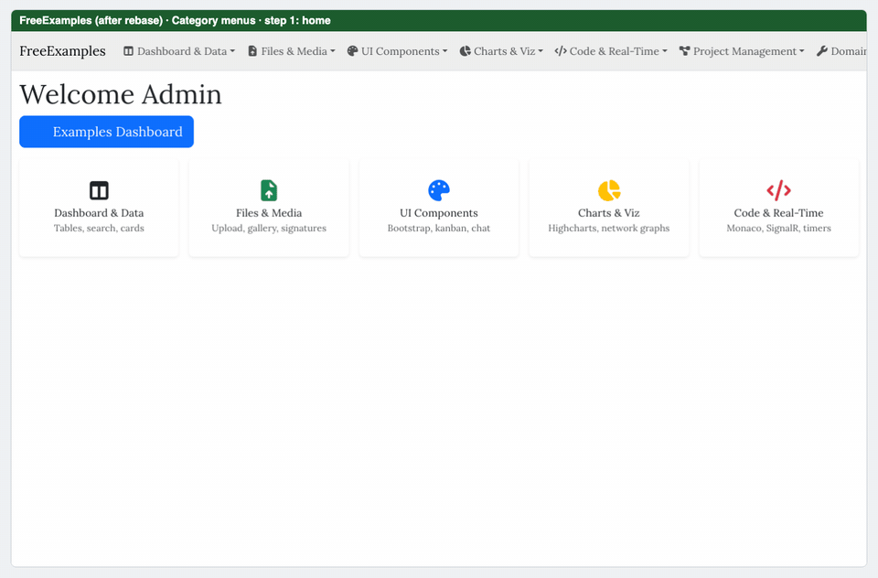


**Major features (representative pages)**

| Category | Routes |
|---|---|
| Dashboard & Data | `/Examples/Dashboard`, `/Examples/SampleItems`, `/Examples/SearchAutocomplete` |
| Files & Media | `/Examples/FileDemo`, `/Examples/ImageGallery`, `/Examples/SignatureDemo` |
| UI Components | `/Examples/BootstrapShowcase`, `/Examples/KanbanBoard`, `/Examples/WizardDemo`, `/Examples/CommandPalette` |
| Charts & Viz | `/Examples/ChartsDashboard` (Highcharts), `/Examples/NetworkGraph` (vis-network) |
| Code & Real-Time | `/Examples/CodeEditor` (Monaco), `/Examples/CodePlayground`, `/Examples/SignalRDemo`, `/Examples/ApiKeyDemo` |
| Project Management | `/Examples/Projects`, `/Examples/Tickets`, `/Examples/BoardViews`, `/Examples/SprintPlanning`, `/Examples/Backlog` |
| Domain Workflows | `/{TenantCode}/Examples/WorkOrders` |

**How it differs from base FreeCRM** (commit `2f330d39`: 161 added, 9 modified)
- **Hooks (10 lines):**
  - `Program.App.cs` has 3.
  - `Helpers.App.cs` has 3: icons, menu, SignalR.
  - `DataAccess.App.cs` has 1: language.
  - `Modules.App.razor` has 2: the CSS link in `head`, and `<FreeExamples_App_Modules Module="body" />` in stock's renamed `bodymiddle` section.
  - `Index.App.razor` has 1.
- **App code:** 128 `FreeExamples.App.*` files, nearly all of them the 105 pages. This is over the 50-file target on purpose, because merging pages would change behaviour.
- **Extra projects:** NuGetClient, NuGetClientPublisher, TestClient and DatabaseMigration.

**Deleted or changed in the rebase**
- **Old tools:** the two `.exe` tools, about 700 KB.
- **FreeCRM test pages:** 6 removed.
- **Merged files:**
  - DataObjects 14 → 1.
  - DataAccess 3 → 1.
  - Controllers 6 → 1.
  - 5 Services and Middleware files → `FreeExamples.App.Program.cs`.
- **No regenerable output:** this app had none to remove.
- **Rebuilt in app code instead of FreeCRM files:**
  - the home category cards (`FreeExamples.App.UI.Index.razor`);
  - the dropdown menus, now stock `MenuItem.Children`;
  - the Monaco language switch, through stock's public `Editor`.

**Fixes forced by e22e953:**
- `DropdownItems` became `Children`.
- The Monaco API change.
- Removed the write-only `Subscribers_On*` lines from 105 pages; stock removed that property.

**Before and after.** The Charts dashboard draws its charts again, because stock FreeCRM now loads Highcharts:

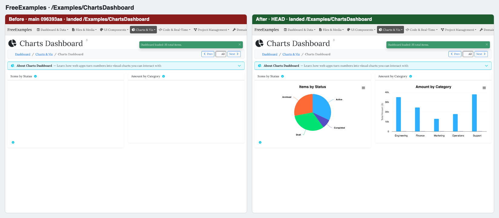
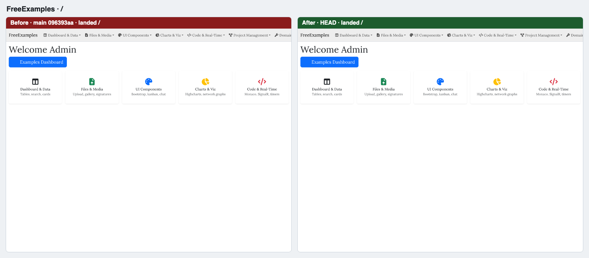

**Route-by-route evidence**

**Crawl:** 143 routes; logged in on both sides: yes.

| Verdict | Routes | Meaning |
|---|---|---|
| same | 106 | Same landing page, heading and text; pixels within 1.5% |
| same content | 4 | Same landing page, heading and text; pixels differ (page chrome moved) |
| changed | 33 | Listed below with the reason |

| Route | Before → after landing | Reason |
|---|---|---|
| `/Authorization/InvalidUser` | `/Authorization/InvalidUser` → `/Authorization/InvalidUser` | Stock e22e953: heading is now "Invalid User" (was "INVALID USER"). |
| `/DoubleClick` | `/DoubleClick` → `/` | FreeCRM sample test page: removed by Util (SamplePages not kept), so it now falls back to home. |
| `/DynamicComponent` | `/DynamicComponent` → `/DynamicComponent` | FreeCRM sample test page: removed by Util (SamplePages not kept), so it now falls back to home. |
| `/Error` | `/` → `/Error` | Stock e22e953: /Error handling. |
| `/Examples/ChartsDashboard` | `/Examples/ChartsDashboard` → `/Examples/ChartsDashboard` | Charts now render (stock e22e953 loads Highcharts); before, both chart panels were empty. |
| `/Examples/TimerDemo` | `/Examples/TimerDemo` → `/Examples/TimerDemo` | Live timer value (clock noise). |
| `/Monaco` | `/Monaco` → `/` | FreeCRM sample test page: removed by Util (SamplePages not kept), so it now falls back to home. |
| `/PasswordChanged` | `/PasswordChanged` → `/PasswordChanged` | Before: Blazor error bar still showing from an earlier page (see NetworkGraph); page content is the same. |
| `/Plugins` | `/Plugins` → `/` | FreeCRM sample test page: removed by Util (SamplePages not kept), so it now falls back to home. |
| `/Profile` | `/Profile` → `/Profile` | Stock e22e953: Profile page layout. |
| `/Settings` | `/Settings` → `/Settings` | Before: Blazor error bar still showing from an earlier page (see NetworkGraph); page content is the same. |
| `/Settings/AddDepartment` | `/` → `/` | Before: Blazor error bar still showing from an earlier page (see NetworkGraph); page content is the same. |
| `/Settings/AddDepartmentGroup` | `/` → `/` | Before: Blazor error bar still showing from an earlier page (see NetworkGraph); page content is the same. |
| `/Settings/AddTag` | `/` → `/` | Before: Blazor error bar still showing from an earlier page (see NetworkGraph); page content is the same. |
| `/Settings/AddTenant` | `/Settings/AddTenant` → `/Settings/AddTenant` | Before: Blazor error bar still showing from an earlier page (see NetworkGraph); page content is the same. |
| `/Settings/AddUser` | `/Settings/AddUser` → `/Settings/AddUser` | Before: Blazor error bar still showing from an earlier page (see NetworkGraph); page content is the same. |
| `/Settings/AddUserGroup` | `/Settings/AddUserGroup` → `/Settings/AddUserGroup` | Before: Blazor error bar still showing from an earlier page (see NetworkGraph); page content is the same. |
| `/Settings/AppSettings` | `/Settings/AppSettings` → `/Settings/AppSettings` | Before: Blazor error bar still showing from an earlier page (see NetworkGraph); page content is the same. |
| `/Settings/DeletedRecords` | `/Settings/DeletedRecords` → `/Settings/DeletedRecords` | Before: Blazor error bar still showing from an earlier page (see NetworkGraph); page content is the same. |
| `/Settings/DepartmentGroups` | `/` → `/` | Before: Blazor error bar still showing from an earlier page (see NetworkGraph); page content is the same. |
| `/Settings/Departments` | `/` → `/` | Before: Blazor error bar still showing from an earlier page (see NetworkGraph); page content is the same. |
| `/Settings/Files` | `/Settings/Files` → `/Settings/Files` | Before: Blazor error bar still showing from an earlier page (see NetworkGraph); page content is the same. |
| `/Settings/Language` | `/Settings/Language` → `/Settings/Language` | Before: Blazor error bar still showing from an earlier page (see NetworkGraph); page content is the same. |
| `/Settings/Tags` | `/` → `/` | Before: Blazor error bar still showing from an earlier page (see NetworkGraph); page content is the same. |
| `/Settings/Tenants` | `/Settings/Tenants` → `/Settings/Tenants` | Before: Blazor error bar still showing from an earlier page (see NetworkGraph); page content is the same. |
| `/Settings/UDF` | `/` → `/` | Before: Blazor error bar still showing from an earlier page (see NetworkGraph); page content is the same. |
| `/Settings/UserGroups` | `/` → `/` | Before: Blazor error bar still showing from an earlier page (see NetworkGraph); page content is the same. |
| `/Settings/Users` | `/Settings/Users` → `/Settings/Users` | Stock e22e953: Users table markup (same data, cells render separately). |
| `/Setup` | `/Setup` → `/Setup` | Before: Blazor error bar still showing from an earlier page (see NetworkGraph); page content is the same. |
| `/SortTest` | `/` → `/` | Both versions send this FreeCRM test page to home in this configuration; only the page chrome differs. |
| `/TimerTest` | `/` → `/TimerTest` | Both versions send this FreeCRM test page to home in this configuration; only the page chrome differs. |
| `/not-found` | `/not-found` → `/not-found` | Stock e22e953: unknown routes now show a "Not Found" page instead of home. |
| `/tenant1/Authorization/NoLocalAccout` | `/tenant1/Authorization/NoLocalAccout` → `/tenant1/Authorization/NoLocalAccout` | Before: Blazor error bar still showing from an earlier page (see NetworkGraph); page content is the same. |

<details><summary>110 routes with the same content</summary>

`/` · `/About` · `/Authorization/AccessDenied` · `/Authorization/NoLocalAccount` · `/ChangePassword` · `/Examples/ApiKeyDemo` · `/Examples/Backlog` · `/Examples/BacklogV1` · `/Examples/BacklogV2` · `/Examples/BacklogV3` · `/Examples/BacklogV4` · `/Examples/BoardViews` · `/Examples/BoardViewsV1` · `/Examples/BoardViewsV2` · `/Examples/BoardViewsV3` · `/Examples/BoardViewsV4` · `/Examples/BootstrapShowcase` · `/Examples/BootstrapV1` · `/Examples/BootstrapV10` · `/Examples/BootstrapV11` · `/Examples/BootstrapV12` · `/Examples/BootstrapV2` · `/Examples/BootstrapV3` · `/Examples/BootstrapV4` · `/Examples/BootstrapV5` · `/Examples/BootstrapV6` · `/Examples/BootstrapV7` · `/Examples/BootstrapV8` · `/Examples/BootstrapV9` · `/Examples/Carousel` · `/Examples/ChartsV1` · `/Examples/ChartsV2` · `/Examples/ChartsV3` · `/Examples/ChartsV4` · `/Examples/ChartsV5` · `/Examples/ChatView` · `/Examples/CodeEditor` · `/Examples/CodeEditorV1` · `/Examples/CodeEditorV2` · `/Examples/CodeEditorV3` · `/Examples/CodeEditorV4` · `/Examples/CodeEditorV5` · `/Examples/CodePlayground` · `/Examples/CommandPalette` · `/Examples/CommentThread` · `/Examples/ComparisonTable` · `/Examples/Dashboard` · `/Examples/EditSampleItem/New` · `/Examples/FileDemo` · `/Examples/FileDemoV1` · `/Examples/FileDemoV2` · `/Examples/FileDemoV3` · `/Examples/FileDemoV4` · `/Examples/FileDemoV5` · `/Examples/FileDemoV6` · `/Examples/GitBrowser` · `/Examples/ImageGallery` · `/Examples/ItemCards` · `/Examples/KanbanBoard` · `/Examples/NetworkGraph` · `/Examples/NetworkGraphV1` · `/Examples/NetworkGraphV2` · `/Examples/PipelineTracker` · `/Examples/Projects` · `/Examples/ProjectsV1` · `/Examples/ProjectsV2` · `/Examples/ProjectsV3` · `/Examples/ProjectsV4` · `/Examples/SampleItems` · `/Examples/SampleItemsV1` · `/Examples/SampleItemsV2` · `/Examples/SampleItemsV3` · `/Examples/SampleItemsV4` · `/Examples/SampleItemsV5` · `/Examples/SearchAutocomplete` · `/Examples/SignalRDemo` · `/Examples/SignalRV1` · `/Examples/SignalRV2` · `/Examples/SignalRV3` · `/Examples/SignalRV4` · `/Examples/SignalRV5` · `/Examples/SignatureDemo` · `/Examples/SignatureV1` · `/Examples/SignatureV2` · `/Examples/SignatureV3` · `/Examples/SignatureV4` · `/Examples/SignatureV5` · `/Examples/SprintPlanning` · `/Examples/SprintPlanningV1` · `/Examples/SprintPlanningV2` · `/Examples/SprintPlanningV3` · `/Examples/SprintPlanningV4` · `/Examples/StatusBoard` · `/Examples/Tickets` · `/Examples/TicketsV1` · `/Examples/TicketsV2` · `/Examples/TicketsV3` · `/Examples/TicketsV4` · `/Examples/TimerV1` · `/Examples/TimerV2` · `/Examples/TimerV3` · `/Examples/TimerV4` · `/Examples/TimerV5` · `/Examples/WizardDemo` · `/Examples/WorkOrders` · `/Examples/WorkOrdersV1` · `/Examples/WorkOrdersV2` · `/Examples/WorkOrdersV3` · `/InvalidTenantCode` · `/MissingTenantCode`

</details>

Raw results: [`RebaseReport/FreeExamples/evidence-compare.json`](RebaseReport/FreeExamples/evidence-compare.json)

About the 33 changed routes:
- **Most are a crawl artifact on the before side.** Both versions throw `ReferenceError: vis is not defined` on `/Examples/NetworkGraph`, which shows Blazor's error bar. The crawl stays in one session, so the bar was still on screen for the later before-pages, and their content is otherwise the same.
- **NetworkGraph itself is broken in both versions.** vis-network is loaded (`FreeExamples.App.Modules.razor:10`), but `vis` is undefined when the chart renders. A likely cause, not verified: Monaco's AMD loader defines `window.define`, so the vis UMD bundle registers as an AMD module instead of the global `vis`.

<details><summary>All FreeExamples feature screenshots</summary>

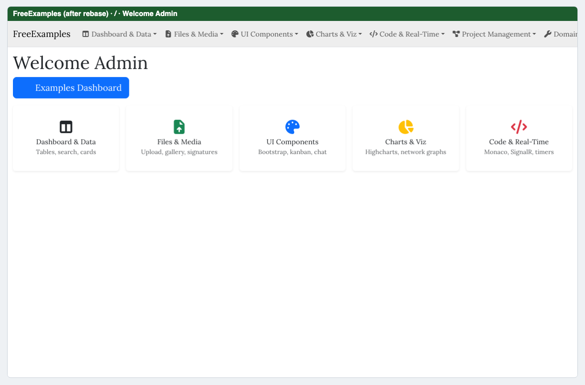
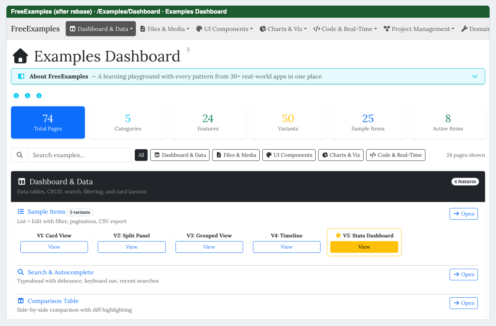
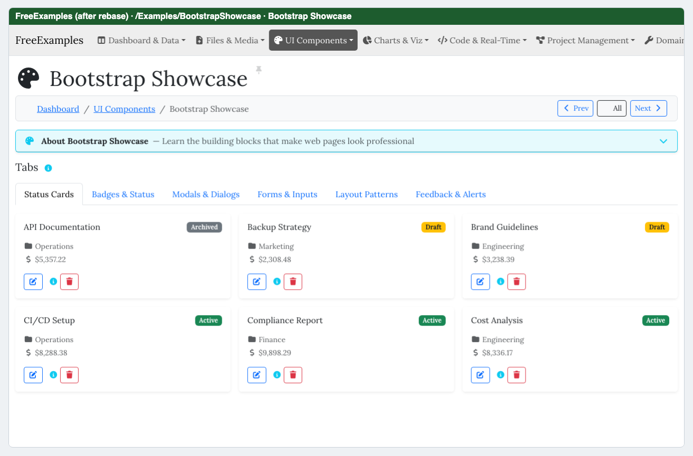
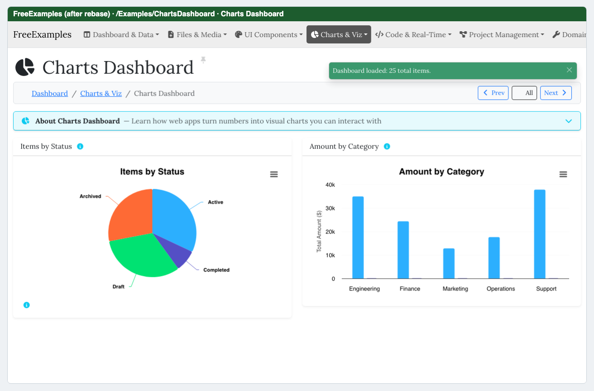
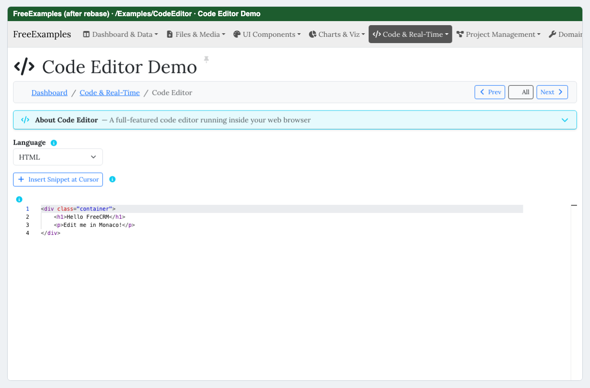
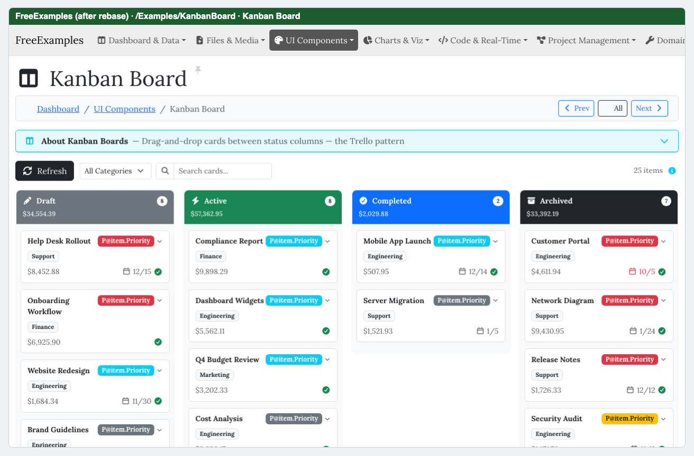


</details>

**Open items:**
- **Network Graph:** fix the `vis` bug.
- **Dead files:** delete `FreeExamples.Client/wwwroot/js/highcharts/` (5 files, 486 KB, unreferenced since stock loads `lib/highcharts`).
- **`.gitignore`:** it has no `runs/` rule.

---

## FreeBlazorExample

**What it is.** A showcase host for the **FreeBlazorExtended** component library, which now lives inside this folder:
- `/showcase` is a live gallery of core FreeBlazor controls;
- six feature modules (101–107);
- a 45-page V1/V2/V3 variant gallery.

A Windows-service companion agent feeds the agent-monitoring feature.


**Major features**

| Feature | Route |
|---|---|
| Showcase home (via "View Component Showcase" on `/`) | `/showcase` |
| Component catalog | `/showcase/catalog` |
| Feature modules | `/showcase/feature101-dynamic-forms`, `feature102-multi-view-sync`, `feature103-calendar`, `feature104-user-preferences`, `feature105-agent-monitoring`, `feature107-hierarchical-tree` |
| Core demos (10) | `/showcase/autocomplete`, `/showcase/datetimepicker`, `/showcase/multiselect`, … |
| External browsers | `/showcase/github-repo`, `/showcase/generic-git`, `/showcase/smartsheet` (need credentials) |
| Variant gallery (15 families × 3) | `/showcase/{family}/v1…v3`, e.g. `/showcase/kanbanboard/v1`, `/showcase/wizard/v1` |

**How it differs from base FreeCRM** (commit `84604c8a`: 208 added, 10 modified)
- **Hooks (6 lines):**
  - `Program.App.cs` has 3.
  - `Modules.App.razor` has 2: `head` and `bodymiddle`.
  - `Index.App.razor` has 1.
  - Also, the About page text was reworded inside its hook section.
- **The one approved FreeCRM-file exception:** the client `Program.cs:30-32` gets a tagged comment plus `builder.Services.AddFreeBlazorExampleApp();`. FreeCRM has no client-side hook, and the showcase breaks without this line.
- **App code:** 54 `FreeBlazorExample.App.*` files. This is over 50 on purpose. The 45 variant pages are now one component per family.
- **Extra projects:** the FreeBlazorExtended library (125 files), FreeBlazorExtended.Agent, ShowcaseTool and Docs.
- **`Directory.Build.props`:** holds the library references and namespaces, so FreeCRM's `.csproj` files stay stock.

**Deleted or changed in the rebase**
- **Showcase output:** `Docs/showcase/runs/` (2,907 files, 83.3 MB) and the ShowcaseTool output `showcase-2026-05-08-1031/` (202 files, 6 MB).
- **Theme:** `wsu-theme.css` was replaced by `FreeBlazorExample.App.css`.
- **Local assets:** the local bootstrap-icons and thumbmarkjs files were removed; they now load from a CDN.
- **Dropped FreeCRM-file edits:** the skip link, the SignalR guard and the seed-race fix (see [Changes common to every app](#changes-common-to-every-app)).

**Fixes forced by e22e953:** stock restored `RenderFiles` and `SelectFile`, so the showcase's same-named tags are now fully qualified (RZ9985).

**Before and after.** Settings → Files said "Not Found" before, because the old app had removed it. It works again:


**Route-by-route evidence**

**Crawl:** 101 routes; logged in on both sides: yes.

| Verdict | Routes | Meaning |
|---|---|---|
| same | 2 | Same landing page, heading and text; pixels within 1.5% |
| same content | 94 | Same landing page, heading and text; pixels differ (page chrome moved) |
| changed | 5 | Listed below with the reason |

On every page: removed "Skip to main content". This is ignored in the per-route verdicts.

| Route | Before → after landing | Reason |
|---|---|---|
| `/Authorization/InvalidUser` | `/Authorization/InvalidUser` → `/Authorization/InvalidUser` | Stock e22e953: heading is now "Invalid User" (was "INVALID USER"). |
| `/Profile` | `/Profile` → `/Profile` | Stock e22e953: Profile page layout. |
| `/Settings/Files` | `/Settings/Files` → `/Settings/Files` | Before: "Not Found" (the old app had removed the stock Files page); after: stock Files page restored. |
| `/Settings/Users` | `/Settings/Users` → `/Settings/Users` | Stock e22e953: Users table markup (same data, cells render separately). |
| `/showcase/catalog` | `/showcase/catalog` → `/showcase/catalog` | Only the catalog's own explanatory text changed (it describes the new file layout). |

<details><summary>96 routes with the same content</summary>

`/` · `/About` · `/Authorization/AccessDenied` · `/Authorization/NoLocalAccount` · `/ChangePassword` · `/Error` · `/InvalidTenantCode` · `/MissingTenantCode` · `/PasswordChanged` · `/Settings` · `/Settings/AddDepartment` · `/Settings/AddDepartmentGroup` · `/Settings/AddTag` · `/Settings/AddTenant` · `/Settings/AddUser` · `/Settings/AddUserGroup` · `/Settings/AppSettings` · `/Settings/DeletedRecords` · `/Settings/DepartmentGroups` · `/Settings/Departments` · `/Settings/Language` · `/Settings/Tags` · `/Settings/Tenants` · `/Settings/UDF` · `/Settings/UserGroups` · `/Setup` · `/not-found` · `/showcase` · `/showcase/aboutsection/v1` · `/showcase/aboutsection/v2` · `/showcase/aboutsection/v3` · `/showcase/autocomplete` · `/showcase/autogrowtext` · `/showcase/carousel/v1` · `/showcase/carousel/v2` · `/showcase/carousel/v3` · `/showcase/commandpalette/v1` · `/showcase/commandpalette/v2` · `/showcase/commandpalette/v3` · `/showcase/confirmationcode` · `/showcase/datetimepicker` · `/showcase/deleteconfirmation` · `/showcase/examplenav/v1` · `/showcase/examplenav/v2` · `/showcase/examplenav/v3` · `/showcase/feature101-dynamic-forms` · `/showcase/feature102-multi-view-sync` · `/showcase/feature103-calendar` · `/showcase/feature104-user-preferences` · `/showcase/feature105-agent-monitoring` · `/showcase/feature107-hierarchical-tree` · `/showcase/generic-git` · `/showcase/getinput` · `/showcase/github-repo` · `/showcase/imagegallery/v1` · `/showcase/imagegallery/v2` · `/showcase/imagegallery/v3` · `/showcase/infotip/v1` · `/showcase/infotip/v2` · `/showcase/infotip/v3` · `/showcase/kanbanboard/v1` · `/showcase/kanbanboard/v2` · `/showcase/kanbanboard/v3` · `/showcase/multiselect` · `/showcase/networkchart/v1` · `/showcase/networkchart/v2` · `/showcase/networkchart/v3` · `/showcase/pagedrecordset` · `/showcase/pipelinetracker/v1` · `/showcase/pipelinetracker/v2` · `/showcase/pipelinetracker/v3` · `/showcase/renderfiles/v1` · `/showcase/renderfiles/v2` · `/showcase/renderfiles/v3` · `/showcase/selectfile/v1` · `/showcase/selectfile/v2` · `/showcase/selectfile/v3` · `/showcase/signature/v1` · `/showcase/signature/v2` · `/showcase/signature/v3` · `/showcase/smartsheet` · `/showcase/stringlist` · `/showcase/timeline/v1` · `/showcase/timeline/v2` · `/showcase/timeline/v3` · `/showcase/timer/v1` · `/showcase/timer/v2` · `/showcase/timer/v3` · `/showcase/toastcontainer/v1` · `/showcase/toastcontainer/v2` · `/showcase/toastcontainer/v3` · `/showcase/togglepassword` · `/showcase/wizard/v1` · `/showcase/wizard/v2` · `/showcase/wizard/v3` · `/tenant1/Authorization/NoLocalAccout`

</details>

Raw results: [`RebaseReport/FreeBlazorExample/evidence-compare.json`](RebaseReport/FreeBlazorExample/evidence-compare.json)

<details><summary>All FreeBlazorExample feature screenshots</summary>


</details>

**Open items:**
- **Version mismatch:** the library pins FreeBlazor 1.0.62 while the host uses 2.0.9.
- **Offline hosts:** icons and the fingerprint script now come from jsDelivr, so offline hosts lose them.
- **Skip link:** gone.

---

## FreePlugins

**What it is.** A plugin SDK and test host. It has two authoring models that share one pipeline: drop a `.cs` or `.plugin` file in `PluginFiles/`, or ship a compiled plugin with a `[Plugin]` attribute. It includes `FreePlugins.Abstractions`, the `.Integration` bridge and six example plugin projects. The app has **no pages of its own**. It keeps FreeCRM's test pages (`--keep` SamplePages, SamplePlugins and Workflows) and adds an admin menu to reach them.


**Major features**

| Feature | Route |
|---|---|
| Plugin Testing (Example Plugins) | `/Plugins` |
| Monaco, Double-Click, HTML Editor, Workflows, Dynamic Component test pages | `/Monaco`, `/DoubleClick`, `/HtmlEditor`, `/WorkflowsTest`, `/DynamicComponent` |
| Admin dropdown (admin only) | Example Plugins, Monaco, Double Click, Sort, Timer |

**How it differs from base FreeCRM** (commit `12e87cf7`: 195 added, 7 modified)
- **Hooks (4 lines):**
  - `Program.App.cs` has 2: `ModifyBuilderStart` and `ModifyBuilderEnd`.
  - `Helpers.App.cs` has 2: icons, admin menu.
- **App code:** 3 `FreePlugins.App.*` files.
- **Plugin references:** `FreePlugins/FreePlugins/Directory.Build.props` adds the 8 plugin project references to the server only.
- **Extra projects:** Abstractions, Abstractions.Integration, AuthExamplePlugin, DataAccessExamplePlugin, ExamplePlugin, SamplePlugin, TenantRestrictedPlugin, UserUpdateExamplePlugin and Docs, plus the BlazorApp1 test site and `FreePlugins.Docs`.

**Deleted or changed in the rebase**
- **Flattened:** `FreePluginsV1/` was removed as a level.
- **Showcase output:** 2,085 files, 38.6 MB.
- **Old tools:** the two `.exe` tools.
- **Empty placeholders removed:** `UIExamplePlugin` (its `.cs` was 0 bytes), `UIElement.cs` and `PluginUIRenderer.razor`.
- **Rebuilt in app code:**
  - the old edit to `NavigationMenu.razor` ("Plugins" dropdown) is now the admin-menu hook;
  - the compiled-plugin registration from `Program.cs` is now in `FreePlugins.App.Program.cs`.
- **"Plugin Dashboard" menu entry:** dropped; it pointed at a page that never existed.

**Fixes forced by e22e953:** `Microsoft.Extensions.Hosting.Abstractions` went from 10.0.0-preview to 10.0.13 (NU1605).

**Before and after.** Every page now has stock e22e953's "Test Pages" menu in place of the old "Plugins" menu. Test pages the old app was missing, such as Workflows, now render:


**Route-by-route evidence**

**Crawl:** 73 routes (33 belong to the bundled BlazorApp1 test site); logged in on both sides: yes.

| Verdict | Routes | Meaning |
|---|---|---|
| same | 17 | Same landing page, heading and text; pixels within 1.5% |
| same content | 3 | Same landing page, heading and text; pixels differ (page chrome moved) |
| changed | 20 | Listed below with the reason |

On every page: removed "Plugins"; added "Test Pages". This is ignored in the per-route verdicts.

| Route | Before → after landing | Reason |
|---|---|---|
| `/` | `/` → `/` | Stock e22e953 "Test Pages" menu (kept modules). |
| `/Authorization/InvalidUser` | `/Authorization/InvalidUser` → `/Authorization/InvalidUser` | Stock e22e953: heading is now "Invalid User" (was "INVALID USER"). |
| `/DoubleClick` | `/DoubleClick` → `/DoubleClick` | FreeCRM sample test page: stock e22e953 version. |
| `/DynamicComponent` | `/` → `/DynamicComponent` | FreeCRM sample test page: kept by this app's Util keep list; before, it was missing and fell back to home. |
| `/Error` | `/Error` → `/` | Stock e22e953: /Error handling. |
| `/HtmlEditor` | `/HtmlEditor` → `/HtmlEditor` | FreeCRM sample test page: kept by this app's Util keep list; before, it was missing and fell back to home. |
| `/Monaco` | `/Monaco` → `/Monaco` | FreeCRM sample test page: stock e22e953 version. |
| `/Profile` | `/Profile` → `/Profile` | Stock e22e953: Profile page layout. |
| `/Settings/AddDepartment` | `/` → `/` | Stock e22e953 "Test Pages" menu (kept modules). |
| `/Settings/AddDepartmentGroup` | `/` → `/` | Stock e22e953 "Test Pages" menu (kept modules). |
| `/Settings/AddTag` | `/` → `/` | Stock e22e953 "Test Pages" menu (kept modules). |
| `/Settings/DepartmentGroups` | `/` → `/` | Stock e22e953 "Test Pages" menu (kept modules). |
| `/Settings/Departments` | `/` → `/` | Stock e22e953 "Test Pages" menu (kept modules). |
| `/Settings/Tags` | `/` → `/` | Stock e22e953 "Test Pages" menu (kept modules). |
| `/Settings/UDF` | `/` → `/` | Stock e22e953 "Test Pages" menu (kept modules). |
| `/Settings/UserGroups` | `/` → `/` | Stock e22e953 "Test Pages" menu (kept modules). |
| `/Settings/Users` | `/Settings/Users` → `/Settings/Users` | Stock e22e953: Users table markup (same data, cells render separately). |
| `/SortTest` | `/` → `/` | Both versions send this FreeCRM test page to home in this configuration; only the page chrome differs. |
| `/TimerTest` | `/` → `/` | Both versions send this FreeCRM test page to home in this configuration; only the page chrome differs. |
| `/WorkflowsTest` | `/WorkflowsTest` → `/WorkflowsTest` | FreeCRM sample test page: kept by this app's Util keep list; before, it was missing and fell back to home. |

33 BlazorApp1 test-site routes (`/Account/*`, `/counter`, `/weather`, `/auth`) were crawled too; they are not part of the app and are left out of the counts above.

<details><summary>20 routes with the same content</summary>

`/About` · `/Authorization/AccessDenied` · `/Authorization/NoLocalAccount` · `/ChangePassword` · `/InvalidTenantCode` · `/MissingTenantCode` · `/PasswordChanged` · `/Plugins` · `/Settings` · `/Settings/AddTenant` · `/Settings/AddUser` · `/Settings/AddUserGroup` · `/Settings/AppSettings` · `/Settings/DeletedRecords` · `/Settings/Files` · `/Settings/Language` · `/Settings/Tenants` · `/Setup` · `/not-found` · `/tenant1/Authorization/NoLocalAccout`

</details>

Raw results: [`RebaseReport/FreePlugins/evidence-compare.json`](RebaseReport/FreePlugins/evidence-compare.json)

<details><summary>All FreePlugins feature screenshots</summary>


</details>

**Open items:**
- **Compiled plugins never appear:** Plugin Testing lists only the three file-based example plugins, in both versions. `LoadCompiledPlugins()` is defined in `CompiledPluginRegistry.cs:114` but never called, so the six compiled plugins are registered in DI but not loaded into the plugin pipeline. This already existed before the rebase.
- **Duplicate navigation:** admins see the same test pages in both "Test Pages" and the admin dropdown.
- **Stale docs:** they still say `Plugins/`; the folder is `PluginFiles/`.
- **`.gitignore`:** it has no `runs/` rule.

---

## FreeLLM

**What it is.** A prompt packager. It reads source files from a folder on the server, lets you pick and filter them, and builds a chunked prompt package to paste into an LLM. It makes no LLM calls itself. The packager is the whole home page.


**Major features**

| Feature | Route | Notes |
|---|---|---|
| Prompt Packager | `/` | Directory path, file list with line counts, extension and wildcard filters, ignored folders, instructions, chunking, copy |
| File API (admin policy) | `api/Data/GetFiles`, `GetFileContents`, `GetFileMetadata` | Server reads local disk; app is loopback-only |

In the walk-through above, entering a folder path loaded 103 files (19 `.cs`, 83 `.razor`). "Select All Visible" then built a 28,707-line package.

<details><summary>Walk-through as still frames</summary>


</details>

**How it differs from base FreeCRM** (commit `586c8439`: 22 added, 6 modified)
- **Hooks (2 lines):** `Program.App.cs` calls `FreeLLMAppModifyBuilderStart`, and `Index.App.razor` renders `<FreeLLM_App_UI_PromptPackager />`.
- **App code:** 8 `FreeLLM.App.*` files: client state (609 lines), the packager UI (356), DataAccess, DataObjects, the API and program setup.
- **Extra content:** the `FreeLLM.Docs` project and `.github/workflows/build-publish.yml`.

**Deleted or changed in the rebase**
- **Showcase output:** 1,025 files, 29 MB.
- **Old tools:** the two `.exe` tools.
- **FreeCRM samples:** the test pages and sample plugins.
- **Merged page:** the old `/files` page was merged into the home page.

**Dropped FreeCRM-file edits:** none.

**Before and after**


**Route-by-route evidence**

**Crawl:** 36 routes; logged in on both sides: yes.

| Verdict | Routes | Meaning |
|---|---|---|
| same | 12 | Same landing page, heading and text; pixels within 1.5% |
| same content | 14 | Same landing page, heading and text; pixels differ (page chrome moved) |
| changed | 10 | Listed below with the reason |

| Route | Before → after landing | Reason |
|---|---|---|
| `/Authorization/InvalidUser` | `/Authorization/InvalidUser` → `/Authorization/InvalidUser` | Stock e22e953: heading is now "Invalid User" (was "INVALID USER"). |
| `/DoubleClick` | `/DoubleClick` → `/` | FreeCRM sample test page: removed by Util (SamplePages not kept), so it now falls back to home. |
| `/Monaco` | `/Monaco` → `/` | FreeCRM sample test page: removed by Util (SamplePages not kept), so it now falls back to home. |
| `/Plugins` | `/Plugins` → `/` | FreeCRM sample test page: removed by Util (SamplePages not kept), so it now falls back to home. |
| `/Profile` | `/Profile` → `/Profile` | Stock e22e953: Profile page layout. |
| `/Settings/Users` | `/Settings/Users` → `/Settings/Users` | Stock e22e953: Users table markup (same data, cells render separately). |
| `/SortTest` | `/` → `/` | Both versions send this FreeCRM test page to home in this configuration; only the page chrome differs. |
| `/TimerTest` | `/` → `/TimerTest` | Both versions send this FreeCRM test page to home in this configuration; only the page chrome differs. |
| `/files` | `/files` → `/files` | The old standalone /files page was merged into the home page; /files now shows the home page. |
| `/not-found` | `/` → `/not-found` | Stock e22e953: unknown routes now show a "Not Found" page instead of home. |

<details><summary>26 routes with the same content</summary>

`/` · `/About` · `/Authorization/AccessDenied` · `/Authorization/NoLocalAccount` · `/ChangePassword` · `/Error` · `/InvalidTenantCode` · `/MissingTenantCode` · `/PasswordChanged` · `/Settings` · `/Settings/AddDepartment` · `/Settings/AddDepartmentGroup` · `/Settings/AddTenant` · `/Settings/AddUser` · `/Settings/AddUserGroup` · `/Settings/AppSettings` · `/Settings/DeletedRecords` · `/Settings/DepartmentGroups` · `/Settings/Departments` · `/Settings/Files` · `/Settings/Language` · `/Settings/Tenants` · `/Settings/UDF` · `/Settings/UserGroups` · `/Setup` · `/tenant1/Authorization/NoLocalAccout`

</details>

Raw results: [`RebaseReport/FreeLLM/evidence-compare.json`](RebaseReport/FreeLLM/evidence-compare.json)

**Open items:**
- **CI workflow:** `.github/workflows/build-publish.yml` names `FreeLLM.sln` and .NET 9, and only runs from a repository root. This predates the rebase.
- **Stale README:** it still mentions `/Plugins` and net9.0.
- **Port:** in Development the app listens on `localhost:5102`, from `appsettings.FreeLLM.App.Development.json`, not the `127.0.0.1:55000` from `UseUrls` that its code comment describes. It is still loopback-only.

---

## FreeSmartsheets

**What it is.** A scaffold for a Smartsheet workspace inventory viewer. **No Smartsheet code exists**, before or after. The README says so, and the `Smartsheets:ApiKey` setting (empty) is never read. What runs is stock FreeCRM under the app's name.


**How it differs from base FreeCRM** (commit `6ebe6392`: 17 added, 6 modified)
- **Hook (1 line):** `Program.App.cs` calls `FreeSmartsheetsAppModifyBuilderStart`, which loads `appsettings.FreeSmartsheets.App*.json`.
- **App code:** 3 `FreeSmartsheets.App.*` files.
- **Extra projects:** Docs.

**Deleted or changed in the rebase**
- **Flattened:** `FreeSmartsheets/FreeSmartsheets/` became one level.
- **Showcase output:** 65 files, 5.4 MB.
- **Old tools:** the two `.exe` tools.
- **FreeCRM samples:** the test pages and 13 sample plugin files.

**Dropped FreeCRM-file edits:** none.

**Before and after.** The home page no longer lists FreeCRM's test pages, and that accounts for most of the changed routes:


**Route-by-route evidence**

**Crawl:** 38 routes; logged in on both sides: yes.

| Verdict | Routes | Meaning |
|---|---|---|
| same | 16 | Same landing page, heading and text; pixels within 1.5% |
| same content | 3 | Same landing page, heading and text; pixels differ (page chrome moved) |
| changed | 19 | Listed below with the reason |

| Route | Before → after landing | Reason |
|---|---|---|
| `/` | `/` → `/` | Home no longer lists the FreeCRM test pages (SamplePages removed by Util). |
| `/Authorization/InvalidUser` | `/Authorization/InvalidUser` → `/Authorization/InvalidUser` | Stock e22e953: heading is now "Invalid User" (was "INVALID USER"). |
| `/DoubleClick` | `/DoubleClick` → `/` | FreeCRM sample test page: removed by Util (SamplePages not kept), so it now falls back to home. |
| `/DynamicComponent` | `/DynamicComponent` → `/DynamicComponent` | FreeCRM sample test page: removed by Util (SamplePages not kept), so it now falls back to home. |
| `/Error` | `/` → `/Error` | Stock e22e953: /Error handling. |
| `/Monaco` | `/Monaco` → `/` | FreeCRM sample test page: removed by Util (SamplePages not kept), so it now falls back to home. |
| `/Plugins` | `/Plugins` → `/` | FreeCRM sample test page: removed by Util (SamplePages not kept), so it now falls back to home. |
| `/Profile` | `/Profile` → `/Profile` | Stock e22e953: Profile page layout. |
| `/Settings/AddDepartment` | `/` → `/` | Home no longer lists the FreeCRM test pages (SamplePages removed by Util). |
| `/Settings/AddDepartmentGroup` | `/` → `/` | Home no longer lists the FreeCRM test pages (SamplePages removed by Util). |
| `/Settings/AddTag` | `/` → `/` | Home no longer lists the FreeCRM test pages (SamplePages removed by Util). |
| `/Settings/DepartmentGroups` | `/` → `/` | Home no longer lists the FreeCRM test pages (SamplePages removed by Util). |
| `/Settings/Departments` | `/` → `/` | Home no longer lists the FreeCRM test pages (SamplePages removed by Util). |
| `/Settings/Tags` | `/` → `/` | Home no longer lists the FreeCRM test pages (SamplePages removed by Util). |
| `/Settings/UDF` | `/` → `/` | Home no longer lists the FreeCRM test pages (SamplePages removed by Util). |
| `/Settings/UserGroups` | `/` → `/` | Home no longer lists the FreeCRM test pages (SamplePages removed by Util). |
| `/Settings/Users` | `/Settings/Users` → `/Settings/Users` | Stock e22e953: Users table markup (same data, cells render separately). |
| `/SortTest` | `/` → `/` | Both versions send this FreeCRM test page to home in this configuration; only the page chrome differs. |
| `/TimerTest` | `/` → `/TimerTest` | Both versions send this FreeCRM test page to home in this configuration; only the page chrome differs. |

<details><summary>19 routes with the same content</summary>

`/About` · `/Authorization/AccessDenied` · `/Authorization/NoLocalAccount` · `/ChangePassword` · `/InvalidTenantCode` · `/MissingTenantCode` · `/PasswordChanged` · `/Settings` · `/Settings/AddTenant` · `/Settings/AddUser` · `/Settings/AddUserGroup` · `/Settings/AppSettings` · `/Settings/DeletedRecords` · `/Settings/Files` · `/Settings/Language` · `/Settings/Tenants` · `/Setup` · `/not-found` · `/tenant1/Authorization/NoLocalAccout`

</details>

Raw results: [`RebaseReport/FreeSmartsheets/evidence-compare.json`](RebaseReport/FreeSmartsheets/evidence-compare.json)

**Open items:**
- **Product gap:** the integration itself doesn't exist yet.
- **Stale README:** it uses the old nested paths and port 5001 (launch settings use 5201 and 7271).
- **About page:** it still says "(Customer Relationship Management)".

---

## ChatWithAI

**What it is.** A FreeCRM scaffold (the projects were named `FreeAI.*`) plus **`ChatWithAI.LocalTests`**, a console that sends a token-budgeted chat to Azure OpenAI using SharpToken and raw REST. The web app has no AI features. The console is the feature.


**How it differs from base FreeCRM** (commit `7c59c1d4`: 20 added, 5 modified)
- **Hook (1 line):** `Program.App.cs` calls `ChatWithAIAppModifyBuilderStart`.
- **App code:** 3 `ChatWithAI.App.*` files.
- **Extra projects:** `ChatWithAI.LocalTests` and `ChatWithAI.Docs`.

**Deleted or changed in the rebase**
- **Renamed:** `FreeAI.*` → `ChatWithAI.*`.
- **Showcase output:** 1,031 files, 21.1 MB.
- **Old tools:** the two `.exe` tools.
- **FreeCRM samples:** removed.
- **LocalTests:** `DataAccess.ChatWithAi.cs` was merged into `Program.cs`.
- **API-key redaction:** the old console printed the first and last 5 characters of the key. It now prints "configured" or "NOT configured".

**The console, before and after,** run with no key configured (the shipped `appsettings.json` has empty values):


- **Before:** it crashed while printing the key, because `Substring(0, 5)` on an empty string fails.
- **After:** it prints "NOT configured", then fails later on the empty endpoint, because the `?? throw` guards only catch `null`, not `""`.

Neither version works without settings. The new one fails later and doesn't print any of the key.

**Before and after (web)**


**Route-by-route evidence**

**Crawl:** 35 routes; logged in on both sides: yes.

| Verdict | Routes | Meaning |
|---|---|---|
| same | 23 | Same landing page, heading and text; pixels within 1.5% |
| same content | 3 | Same landing page, heading and text; pixels differ (page chrome moved) |
| changed | 9 | Listed below with the reason |

| Route | Before → after landing | Reason |
|---|---|---|
| `/Authorization/InvalidUser` | `/Authorization/InvalidUser` → `/Authorization/InvalidUser` | Stock e22e953: heading is now "Invalid User" (was "INVALID USER"). |
| `/DoubleClick` | `/DoubleClick` → `/` | FreeCRM sample test page: removed by Util (SamplePages not kept), so it now falls back to home. |
| `/Error` | `/` → `/Error` | Stock e22e953: /Error handling. |
| `/Monaco` | `/Monaco` → `/` | FreeCRM sample test page: removed by Util (SamplePages not kept), so it now falls back to home. |
| `/Plugins` | `/Plugins` → `/` | FreeCRM sample test page: removed by Util (SamplePages not kept), so it now falls back to home. |
| `/Profile` | `/Profile` → `/Profile` | Stock e22e953: Profile page layout. |
| `/Settings/Users` | `/Settings/Users` → `/Settings/Users` | Stock e22e953: Users table markup (same data, cells render separately). |
| `/TimerTest` | `/` → `/TimerTest` | Both versions send this FreeCRM test page to home in this configuration; only the page chrome differs. |
| `/not-found` | `/not-found` → `/not-found` | Stock e22e953: unknown routes now show a "Not Found" page instead of home. |

<details><summary>26 routes with the same content</summary>

`/` · `/About` · `/Authorization/AccessDenied` · `/Authorization/NoLocalAccount` · `/ChangePassword` · `/InvalidTenantCode` · `/MissingTenantCode` · `/PasswordChanged` · `/Settings` · `/Settings/AddDepartment` · `/Settings/AddDepartmentGroup` · `/Settings/AddTenant` · `/Settings/AddUser` · `/Settings/AddUserGroup` · `/Settings/AppSettings` · `/Settings/DeletedRecords` · `/Settings/DepartmentGroups` · `/Settings/Departments` · `/Settings/Files` · `/Settings/Language` · `/Settings/Tenants` · `/Settings/UDF` · `/Settings/UserGroups` · `/Setup` · `/SortTest` · `/tenant1/Authorization/NoLocalAccout`

</details>

Raw results: [`RebaseReport/ChatWithAI/evidence-compare.json`](RebaseReport/ChatWithAI/evidence-compare.json)

**Open items:**
- **Console guard:** make it fail with a clear message when the endpoint or key is empty.
- **Stale docs:** they say net9.0; the project is net10.0.

---

## Issues found

**Caused by the rebase** (expected consequences of keeping FreeCRM stock, or loose ends):

| # | App | Issue | Suggested fix |
|---|---|---|---|
| 1 | FreeGLBA, FreeAccessibilityChecker, FreeBlazorExample | Skip link and `<main>` landmark gone, plus FreeAccessibilityChecker's aria edits | FreeCRM pull request (MainLayout, StickyMenuIcon, offcanvas titles) |
| 2 | FreeAccessibilityChecker, FreeBlazorExample | SignalR self-post and Highcharts guards gone; FreeBlazorExample's seed-race fix gone | FreeCRM pull request |
| 3 | FreeBlazorExample | bootstrap-icons and thumbmarkjs now load from a CDN; offline hosts lose them | FreeCRM option for local assets |
| 4 | Several | Stale docs: FreeAccessibilityChecker EFModels README, FreePlugins `Plugins/` folder, FreeServicesHub `CRM.*` list, FreeSmartsheets paths and port, `net9.0` mentions; every app's Docs link to `showcase/runs/` | Docs pass |
| 5 | FreeExamples, FreePlugins | No `runs/` rule in `.gitignore`, so regenerated a11y output would be committed; FreeExamples also carries 486 KB of unused Highcharts files | One-line `.gitignore` fix; delete `wwwroot/js/highcharts/` |

**Already there before the rebase** (found while testing):

| # | App | Issue | Evidence |
|---|---|---|---|
| 6 | FreeServicesHub | Home dashboard never renders: `Index.App.razor` uses `FreeServicesHub_App_AgentDashboard`; the component is `FreeServicesHub_App_UI_AgentDashboard` | [screenshot](#freeserviceshub) |
| 7 | FreeExamples | `/Examples/NetworkGraph` throws `ReferenceError: vis is not defined` | [crawl console errors](RebaseReport/FreeExamples/evidence-compare.json) |
| 8 | FreePlugins | Compiled plugins never load: `LoadCompiledPlugins()` is never called | [screenshot](#freeplugins) |
| 9 | ChatWithAI | `LocalTests` crashes when settings are empty | [console](#chatwithai) |
| 10 | FreeLLM | CI workflow names `FreeLLM.sln` and .NET 9 | — |

Owner decisions still open from the handoff:
- **LICENSE:** each app's `LICENSE` names WSU-EIT rather than FreeCRM's author.
- **FreeManager:** it uses the InMemory database in production.
- **FreeServicesHub:** confirm the pipeline repository root.

---

## Re-running the evidence

The harness is in [`RebaseReport/harness/`](RebaseReport/harness/). It needs the .NET 10 SDK, Node 20 or later, ffmpeg and a Playwright Chromium.

```bash
cd RebaseReport/harness && npm install
export CHROMIUM_PATH=...   # optional: a Playwright chromium / headless-shell binary
# one app: export both versions, build, run, crawl, compare (work folder: ../rebase-evidence-work, or $REBASE_WORK)
bash run-app.sh FreeGLBA FreeGLBA FreeGLBA/FreeGLBA/FreeGLBA.csproj
# all ten apps, one at a time (about 2.5 hours on the machine used here)
bash run-all.sh
# images, GIFs and route tables from the captures
node assets.mjs ../../../rebase-evidence-work/ev ../ && node tables.mjs ../../../rebase-evidence-work/ev <out>
```

| Script | What it does |
|---|---|
| `routes.mjs` | Every static `@page` route in a tree |
| `capture.mjs` | Logs in, crawls the routes, records status, landing, heading, masked text and errors, and screenshots |
| `compare.mjs` | Per-route verdicts and pixel diff (1.5%); page-wide text changes reported once |
| `run-app.sh` / `run-all.sh` | Export, build, run, capture and compare one app or all ten |
| `interact.mjs` / `serve.sh` | Scripted interactions (skip link, FreeLLM packager, showcase, menus) |
| `assets.mjs`, `frame.mjs`, `gif.sh`, `term.mjs`, `tables.mjs` | Report images, GIFs, console images and route tables |

`RebaseReport/<App>/evidence-compare.json` holds each app's raw per-route results: verdict, landing paths, headings, text lines removed and added, pixel-difference percentage and console error counts.
